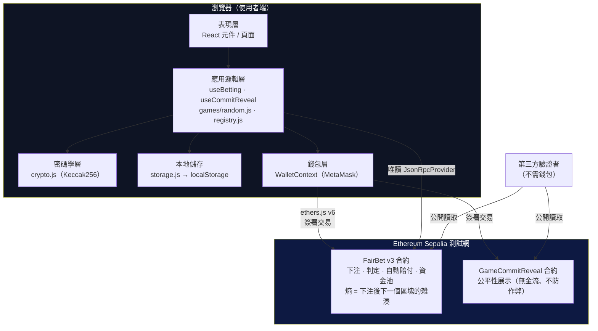
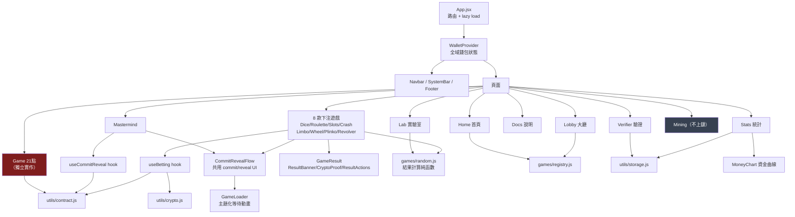
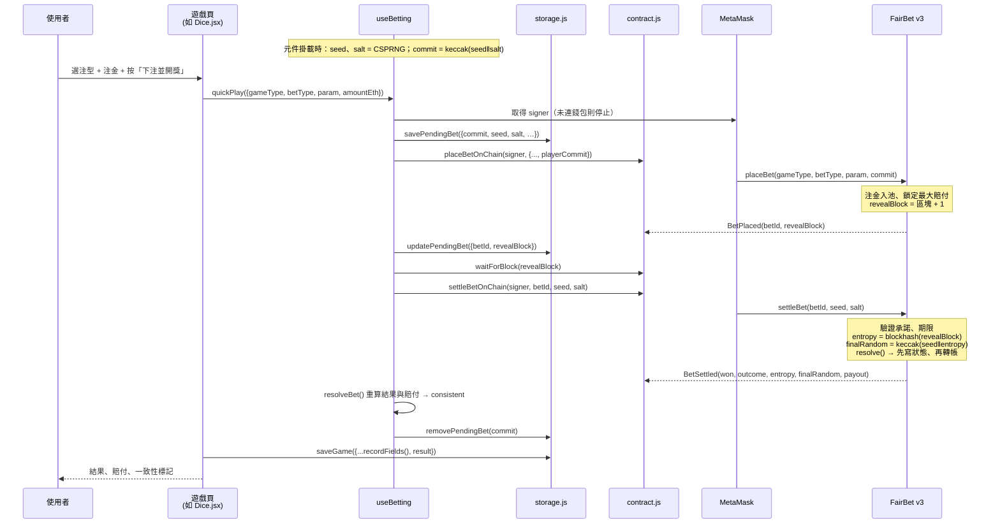
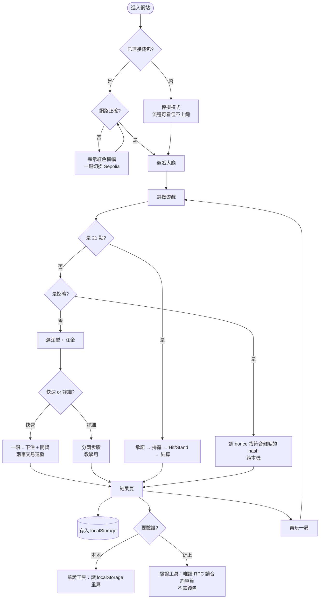

# 系統架構與資料流

> **2026-10-02 更新**：第三、五節已改為 FairBet v3 流程；完整協議規格與部署圖見 [PROTOCOL_V3.md](./PROTOCOL_V3.md)。

## 一、整體架構

**沒有傳統後端、沒有資料庫伺服器。** 這是刻意的架構決策：
權威資料放在**區塊鏈**（不可竄改、公開），本機只放**快取與偏好**（localStorage）。



### 各節點用途

| 節點 | 檔案 | 用途 |
|---|---|---|
| 表現層 | `src/pages/`、`src/components/` | 畫面渲染、使用者互動 |
| 應用邏輯層 | `src/hooks/`、`src/games/` | 遊戲流程狀態機、結果與賠付計算（`resolveBet`）、遊戲註冊 |
| 驗證層 | `src/utils/verify.js`、`scripts/verify-bet.mjs` | 純函數驗證判定；不依賴網站的命令列工具 |
| 密碼學層 | `src/utils/crypto.js` | 種子／salt 生成、承諾計算、承諾驗證 |
| 錢包層 | `src/context/WalletContext.jsx` | MetaMask 連線、網路切換、取得 signer |
| 合約互動 | `src/utils/contract.js` | 封裝所有鏈上讀寫，含唯讀 provider |
| 本地儲存 | `src/utils/storage.js` | 遊戲紀錄索引、UI 偏好、統計聚合 |
| FairBet v3 合約 | `contracts/contracts/FairBet.sol` | 9 種下注遊戲的收注／判定／賠付／資金池；公開 `resolve()` |
| GameCommitReveal | `contracts/contracts/GameCommitReveal.sol` | 純 Commit-Reveal 驗證（21 點、Mastermind 用） |

---

## 二、元件關係圖



> 🔴 紅色 `Game.jsx`（21 點）**自行實作 commit/reveal 流程，未使用共用 hook**——這是已知技術債，見 [TECH_DEBT.md](./TECH_DEBT.md)。
> ⬜ 灰色 `Mining.jsx` **完全不接觸合約**，是純本機 PoW 教學。

---

## 三、資料流程圖（以「鏈上下注」為例，v3）



### 關鍵設計：為什麼前端要「本地重算」再比對？

合約已經算出結果，前端仍用 `resolveBet()` 重算**結果與賠付**並比對，
用來當場證明「前端演算法 ≡ 合約演算法」；不一致會顯示 🚨 警告。
這項一致性另由合約測試把關：測試**直接載入前端的 `random.js`** 與 Solidity 比對。

---

## 四、使用者操作流程圖



---

## 五、資料流追蹤（依功能）

### A. 種子、承諾與熵（下注遊戲，v3）

```
useBetting 掛載
  → generateSeed()、generateSalt()        32-byte CSPRNG（ethers.randomBytes）
  → commit = keccak256(seed‖salt)         useState 惰性初始化，全程不變
  → placeBet 只送 commit（種子仍保密），送出前寫入 pending
  → 合約記 revealBlock = 下注區塊 + 1
  → 等最新區塊 ≥ revealBlock
  → settleBet 送出 seed + salt
  → 合約：keccak256(seed‖salt) == commit；entropy = blockhash(revealBlock)
```

21 點、猜數字（GameCommitReveal）仍是雙種子，兩個都在前端產生，只做公平性展示。

### B. 結果計算（下注遊戲）

```
合約 settleBet
  → finalRandom = keccak256(abi.encodePacked(seed, entropy))
  → resolve(gameType, betType, param, amount, finalRandom)   public pure
      Dice     : uint32(bytes4(fr)) % 6 + 1
      Roulette : uint32(bytes4(fr)) % 37
      Slots    : 三段 bytes4 各 % 6
      Crash/Limbo: crashBps(fr) = min(1e6, 10000·2^52/(2^52 − fr mod 2^52))
      Wheel    : uint256(fr) % 8 → 倍率表
      Plinko   : popcount(uint256(fr) & 0xFFFF) → 17 槽倍率表
      Revolver : uint256(fr) % 6，存活條件 chamber >= 子彈數
  → payout = amount × multiplierBps / 10000（向下取整，含本金）
  → won = payout > amount（淨贏）
  → 寫入 storage、轉帳、emit BetSettled

前端 games/random.js 的 resolveBet() 以完全相同公式重算 → 比對結果與賠付
```

### C. 儲存與統計

```
遊戲結束 → storage.saveGame(record)
  ├─ 完整紀錄 → localStorage['fairchain_game_<gameId>']
  └─ 摘要索引 → localStorage['fairchain_index']（最多 50 筆，新的在前）
                 { gameId, gameType, ts, result, onChain, bet, net }

Stats 頁 → storage.getStats()  聚合索引 → 勝率／鏈上局數／總下注／總淨收益
        → MoneyChart           反轉索引成時間序 → 累積淨收益折線圖
Lobby 頁 → storage.recentGames() → 最近 8 局表格
Verifier → storage.loadGame(id)  → 完整紀錄重算驗證
```

### D. 鏈上驗證（第三方，不需錢包）

```
下注局（FairBet v3）
  → getReadOnlyProvider(可自訂 RPC)，檢查 chainId 與部署鏈一致
  → getBetV3(provider, betId)      一次取得 seed、salt、commit、revealBlock、entropy、finalRandom、outcome、payout
  → getBlockHash(provider, revealBlock)   另外取得區塊雜湊，不採信合約記錄
  → verifyBetV3(bet, blockHash)    承諾 → 熵 → finalRandom → 結果 → 賠付
  → verified / failed / incomplete / expired / pending

下注局（v2，已停用）
  → getBetV2：依結算時間戳二分搜尋區塊，只查附近日誌取種子；錯誤分類
  → verifyBetV2：過期局以 finalRandom 為零辨識；缺種子 → incomplete

公平局（GameCommitReveal）
  → getGameData → 核對承諾與 finalRandom（不代表種子來源獨立）

命令列：npm run verify:bet -- --rpc … --address … --bet …（不經過網站）
```
