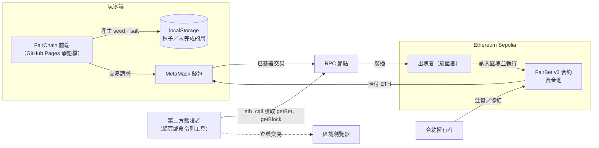
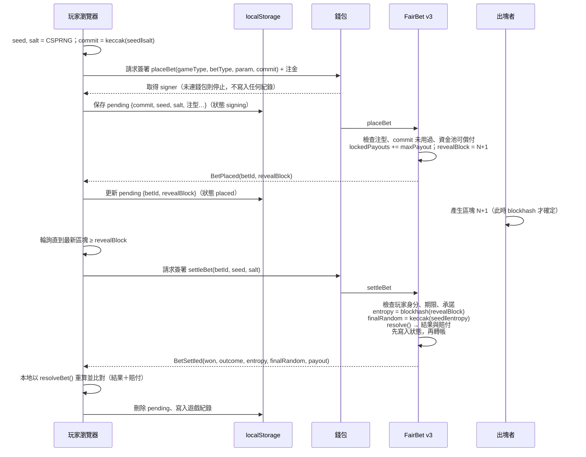
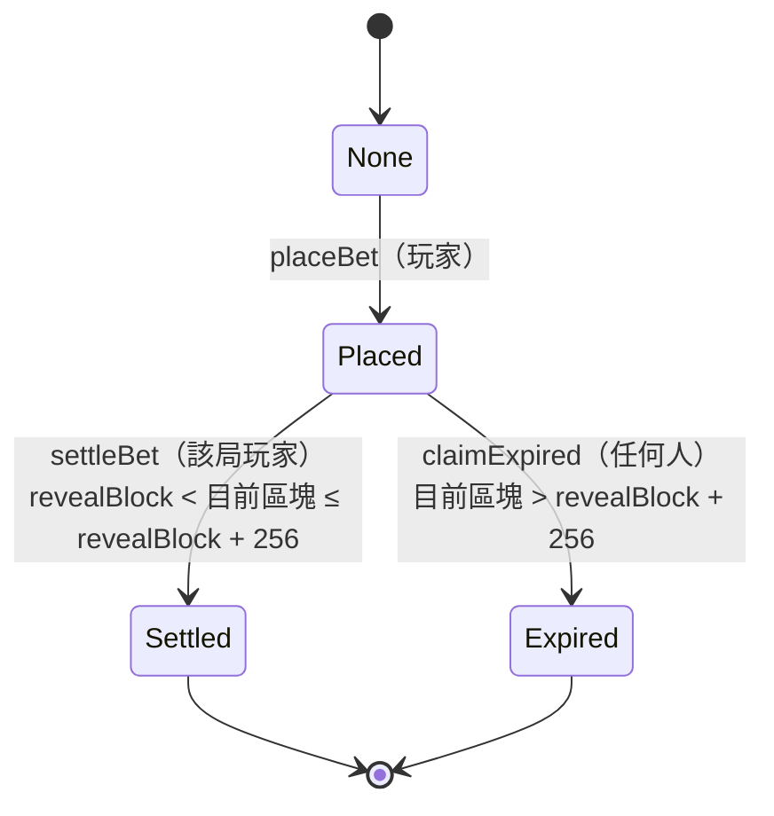

# FairBet v3 協議與合約規格

> 對應程式：`contracts/contracts/FairBet.sol`（RULES_VERSION = 3）、`src/hooks/useBetting.js`、`src/utils/verify.js`
> 回應助教回饋第一部分 01、04–08 與交付物 C。設計取捨的理由見 [DECISIONS.md](./DECISIONS.md)。

## 0. 一句話

**玩家下注時只承諾自己的種子；開獎用的另一半亂數是「下注區塊的下一個區塊」的雜湊。**
玩家簽署下注的當下，那個區塊還不存在，所以沒有人（包括玩家、網站、合約擁有者）能預先挑出必贏的注。

```
commit      = keccak256(seed ‖ salt)                 下注時上鏈
revealBlock = 下注所在區塊 + 1                        合約自動記錄
entropy     = blockhash(revealBlock)                 結算時由合約讀取
finalRandom = keccak256(seed ‖ entropy)
outcome, payout = resolve(gameType, betType, param, amount, finalRandom)   純函數
```

---

## 1. 部署圖：誰在哪裡、每條箭頭由誰簽署、誰付費、誰可以拒絕



| 箭頭 | 傳什麼 | 誰簽署 | 誰付費 | 誰可以拒絕 |
|---|---|---|---|---|
| 前端 → 錢包 | `placeBet`／`settleBet` 交易請求 | — | — | 玩家（拒簽） |
| 錢包 → RPC | 已簽署的交易 | 玩家私鑰 | 玩家（gas） | RPC 可拒收或限流；可換 RPC |
| RPC → 出塊者 | 交易 | — | — | 出塊者可以不納入、或調整排序 |
| 出塊者 → 合約 | 執行交易 | — | — | 合約依規則 `revert` |
| 合約 → 玩家 | 賠付 | 合約（無私鑰） | 資金池 | 收款方是拒收 ETH 的合約時，只會卡住它自己那一局 |
| 擁有者 → 合約 | 注資、提領 | 擁有者私鑰 | 擁有者 | 合約只允許提領「未鎖定」的部分 |
| 驗證者 → RPC | 唯讀查詢（`eth_call`、`eth_getBlockByNumber`） | 不需要 | 不需要 gas；RPC 有服務成本與限流 | RPC 可以拒絕或回傳錯誤資料 → 驗證工具支援換 RPC 交叉驗證，並檢查 chainId |

**名稱的層次**（助教 01）：Ethereum 是平台與網路體系；Sepolia 是其中的測試網，驗證者集合**受許可**，不代表主網的安全性與經濟誘因；Solidity／EVM 是語言與執行環境；Commit-Reveal＋未來區塊雜湊是本專題的**應用層協議**；MetaMask 是錢包；RPC 是讀寫鏈的服務入口。

---

## 2. 角色知識表：每個時點誰知道什麼

| 時點 | 玩家 | 網站前端 | 合約擁有者 | revealBlock 的出塊者 | 其他觀察者 |
|---|---|---|---|---|---|
| ① 簽署 `placeBet` 之前 | seed、注型、注金 | 同玩家（種子在玩家瀏覽器產生） | 無 | 尚未決定 | 無 |
| ② `placeBet` 進入區塊 N | 同上；**注型與注金已鎖定** | 同上 | commit、注型、注金（公開） | commit、注型、注金；**不知道 seed** | 同擁有者 |
| ③ 區塊 N+1 產生後 | 可以算出結果 | 可以算出結果 | 不知道結果 | 知道 blockhash，**不知道 seed → 不知道結果** | 不知道結果 |
| ④ `settleBet` 之後 | 全部公開 | 全部公開 | 全部公開 | 全部公開 | 全部公開 |

三個關鍵問題（助教 06）：

- **誰已經知道結果？** 在 ③ 之前，沒有任何人知道結果。
- **誰還能改投注？** 過了 ② 就沒有人能改。
- **誰能取消或重抽？** 玩家可以在 ③ 之後選擇不揭露，但這等於**放棄注金**，跟輸掉一樣，沒有好處。出塊者可以不出塊或調整區塊內容來改變 blockhash，但他不知道 seed，**無法把結果導向特定方向**（見 §7 串通情境）。

---

## 3. 訊息順序圖



**使用者簽署次數 = 2；系統交易總數 = 2**（逾期時另有任何人都能送出的 `claimExpired`）。
「快速模式」只是讓 UI 連續送出這兩筆交易，它**不會**讓兩筆變成原子操作（助教 05）。第一筆成功、第二筆失敗時，該局留在 pending，重試只會結算同一局，不會重新下注。

---

## 4. 交易規格

| 交易 | sender | 函式與參數 | value | gas 由誰付 | 事件 | 狀態變化 | 確認政策 | 失敗時如何補救 |
|---|---|---|---|---|---|---|---|---|
| 下注 | 玩家 | `placeBet(gameType, betType, param, playerCommit)` | 注金 | 玩家 | `BetPlaced(betId, player, …, playerCommit, revealBlock)` | None → Placed；`lockedPayouts += maxPayout`；`betIdByCommit[commit] = betId` | 等 1 個確認後取得 betId 與 revealBlock | 送出前已存 pending；拒簽就刪除 pending；結果不明（逾時、斷線）時用 `betIdByCommit(commit)` 反查是否已上鏈 |
| 結算 | **限該局玩家** | `settleBet(betId, playerSeed, playerSalt)` | 0 | 玩家 | `BetSettled(betId, player, won, outcome, entropy, finalRandom, payout)` | Placed → Settled；寫入 seed、salt、entropy、finalRandom、outcome、payout；解鎖；轉帳 | 前端等最新區塊 ≥ revealBlock 才送出；1 個確認後顯示結果 | 拒簽、逾時、RPC 錯誤時 pending 保留，可在遊戲頁重試或到大廳「未完成的下注」續結算 |
| 宣告過期 | 任何人 | `claimExpired(betId)` | 0 | 呼叫者 | `BetExpired(betId, forfeited)` | Placed → Expired；解鎖；注金留在資金池 | — | — |
| 注資 | 任何人 | 直接轉帳（`receive`） | 金額 | 呼叫者 | `PoolFunded` | 餘額增加 | — | — |
| 提領 | 擁有者 | `withdraw(amount)` | 0 | 擁有者 | `Withdrawn` | 餘額減少；**不得超過未鎖定部分** | — | — |
| 查詢 | 任何人 | `getBet`、`betIdByCommit`、`resolve`、`poolBalance`（`eth_call`） | — | 不需 gas | — | — | — | RPC 限流或錯誤時換 RPC |

`eth_call` 不需要送付費交易，但 RPC 服務本身仍有成本、限流與可用性問題（助教 05）。

---

## 5. 合約狀態圖



- **Settled 與 Expired 是兩個不同的終態**（v2 把過期也記成 Settled，助教 T05）。
- **結算與過期的有效區間互斥**：在 `revealBlock + 256` 以內只能結算，超過之後只能宣告過期，不存在「同一個區塊兩邊都能執行、誰先誰贏」的情況（助教 T04）。
- 期限內太早結算（`目前區塊 ≤ revealBlock`）→ `TooEarly`；超過期限才結算 → `RevealWindowClosed`。

---

## 6. 授權表

| 函式 | 誰能呼叫 | 前置條件 |
|---|---|---|
| `placeBet` | 任何人（呼叫者即為該局玩家） | 注金 > 0；注型與參數合法；commit 從未用過；資金池可償付最大賠付 |
| `settleBet` | **只有該局玩家** | 狀態為 Placed；在期限區間內；`keccak(seed‖salt) == commit` |
| `claimExpired` | 任何人 | 狀態為 Placed；超過期限 |
| `withdraw` | **只有擁有者**（`immutable`，部署後不可更換） | 金額 ≤ 餘額 − lockedPayouts |
| 注資 | 任何人 | — |
| `resolve`、`maxPayout`、`crashBps` | 任何人（`pure`） | — |

v3 **沒有**莊家角色，也沒有任何人能替玩家提交亂數。擁有者只是資金提供者與管理員，**不參與**任何一局的亂數。

---

## 7. 攻擊者能力表

| 攻擊者 | 能做什麼 | 能否影響結果 | 防禦方式 | 殘餘風險 |
|---|---|---|---|---|
| 玩家 | 選 seed、選注型、決定要不要揭露 | **不能**：下注時開獎區塊還不存在 | revealBlock 一定在下注之後；commit 不可重用 | 可以選擇不揭露，但等於放棄注金 |
| 玩家（重演 v2 攻擊：自己提交「莊家」承諾） | — | **不可能**：介面已沒有莊家參數 | 測試「介面上已無莊家承諾參數」 | — |
| 開獎區塊的出塊者（單獨行動） | 調整區塊內容或不出塊，以改變 blockhash | 能讓結果**改變**，但不知道 seed，**無法導向特定結果** | 玩家種子保密 | 盲目擾動不會改變期望值 |
| **玩家＋出塊者串通** | 玩家把 seed 交給出塊者，出塊者嘗試多種區塊內容挑出有利的雜湊 | **可以** | 本設計無法防禦 | **已知殘餘風險**（Slither weak-prng 標出的就是這一點）；高額或主網應改用 VRF |
| 合約擁有者 | 提領、部署新版本 | 不能改任何一局的結果；不能提領已鎖定資金 | `lockedPayouts` | 可以停止注資，讓新下注因資金池不足被拒（已下注的局不受影響） |
| 網站營運者 | 提供前端程式 | 本身不能決定結果；惡意前端可以把 seed 外洩給出塊者，退化成「串通」情境 | 開放原始碼；獨立命令列驗證工具 | 同串通風險 |
| RPC 節點 | 拒絕服務、回傳錯誤資料 | 不能改鏈上狀態，但可以欺騙單一驗證者 | 驗證工具可換 RPC 交叉驗證並檢查 chainId；區塊雜湊向 RPC 另外取得，不採信合約記錄 | 若所有 RPC 由同一方控制，仍可能被欺騙 |
| 惡意收款合約 | 拒收 ETH、收款時重入 | 只能卡住自己那一局 | 先改狀態再轉帳；測試涵蓋拒收與重入 | — |
| 觀察記憶池（mempool）的人 | 在 `settleBet` 廣播時看到 seed | 不能：此時 blockhash 與注型都已固定 | `settleBet` 限該局玩家 | — |

---

## 8. 資金不變量

| 編號 | 不變量 | 依據 | 測試 |
|---|---|---|---|
| I1 | 任何時刻 **合約餘額 ≥ lockedPayouts** | `placeBet` 只在最大賠付 ≤ 餘額 − 已鎖定時才收注；結算時先解鎖 maxPayout 再付出 ≤ maxPayout 的金額；過期只解鎖不付款；提領 ≤ 餘額 − 已鎖定 | 「並發多局 + owner 提領：不變量全程成立」 |
| I2 | lockedPayouts = 所有 Placed 局的 maxPayout 總和 | 只有 `placeBet` 加、只有 `settleBet`／`claimExpired` 減，且每局只會離開 Placed 一次 | 「下注鎖定最大賠付，結算後解鎖」「過期局解鎖」 |
| I3 | 每一局最多付款一次 | 狀態機：轉帳前已改為 Settled | 「已結算的局不能再結算」「收款時重入只拿到一次賠付」 |
| I4 | 每一局的賠付 ≤ maxPayout | 9 種遊戲的 `resolve` 與 `maxPayout` 使用同一條公式（例如左輪都是 `amount×60000/(6−n)/10000`） | 結算後 `lockedPayouts` 回到 0 |

**四捨五入**：所有倍率以 bps 整數運算後**向下取整**，對玩家不利、對資金池有利，每局最多差 1 wei。`resolve` 的回傳值是**含本金的總返還**。

---

## 9. 期限與時間來源

- 期限以**區塊高度**計算，不用 `block.timestamp`（助教 04「時間來源」）。
- `REVEAL_WINDOW = 256`，原因是 EVM 的 `blockhash()` **只能讀取最近 256 個區塊**；超過就讀不到開獎用的熵。
- 以 Sepolia 每 12 秒一個 slot 計算，約 51 分鐘。若有 slot 沒出塊，實際經過的時間會更長。

---

## 10. 安全性與可完成性（助教 04）

**安全性（不會出現錯誤結果）**

- 結果由合約自己重算，不採信前端。
- seed 被承諾綁定；熵由鏈本身決定；注型在熵產生之前就已鎖定。

**可完成性（誠實的玩家一定能結束這一局）**，需要以下條件同時成立：

1. 玩家在期限內還保有 seed——下注前就寫入 pending，重整也不會遺失。**若在結算前清除瀏覽器資料，就無法結算**，注金會被沒收。
2. 網路與至少一個 RPC 可用。
3. 資金池能支付——由不變量 I1 保證，下注當下就已鎖定。

擁有者**無法**替玩家結算（沒有 seed），也**無法**拒絕支付已鎖定的賠付。

---

## 11. 確認數與最終性（部分處理）

- 前端在交易得到 **1 個確認**後就取 betId、顯示結果（`tx.wait(1)`）。
- Ethereum PoS 要等檢查點投票後才達到 **finality**（約 2 個 epoch，約 13 分鐘）。在那之前若發生**區塊重組**，`revealBlock` 可能被另一個區塊取代，blockhash 會變，同一局的結算結果也可能不同。
- **已做**：結算後，結果頁的 `FinalityBadge` 每 15 秒向 RPC 查詢 `finalized` 區塊，分開標示「已確認、尚未最終確定」與「已最終確定」；驗證頁也會顯示熵所在區塊是否已最終確定。實測的「結算 → 最終確定」時間見 [experiments/](./experiments/)。
- **未做**：重組真的發生時不會自動偵測與重新結算。重組後，原本的 `settleBet` 交易可能被丟棄（該局回到 Placed，玩家可以用同一組種子重新結算）或被重新打包進新的鏈。

---

## 12. 驗證流程

不論是網頁（驗證工具 →「鏈上・下注局」→ v3），還是命令列 `npm run verify:bet -- --rpc … --address … --bet …`，流程都一樣：

1. `getBet(betId)` 讀出 seed、salt、commit、revealBlock、entropy、finalRandom、outcome、payout、注型與注金。
2. **另外**向 RPC 取得 `revealBlock` 的區塊雜湊，不採信合約自己記錄的 entropy。
3. 依序比對：
   - `keccak(seed‖salt) == commit`
   - `entropy == 區塊雜湊`
   - `keccak(seed‖區塊雜湊) == finalRandom`
   - 用 `resolveBet()` 重算的 outcome、payout 是否與紀錄相同
4. 判定：
   - 任一項不符 → **failed**
   - 有任何一項取不到證據 → **incomplete**（不是通過）
   - 全部取得且吻合 → **verified**
   - 另有 expired、pending 兩種狀態，分別如實標示

前端 `resolveBet()` 與合約 `resolve()` 是否一致，由兩層測試把關：合約測試**直接載入前端的 `random.js`** 與 Solidity 比對（9 種遊戲 × 全部注型 × 30 組 + 邊界值）；另有 E2E 測試以前端實際的 `contract.js` 對本地節點跑完整流程。

---

## 13. 與 v2 的差異

| | v2（已停用） | v3 |
|---|---|---|
| 亂數 | keccak(玩家種子 ‖ 莊家種子)，**兩個都由玩家瀏覽器產生** | keccak(玩家種子 ‖ 下注後下一個區塊的雜湊) |
| 玩家能否下注前知道結果 | **能**（助教 T03：3/3 必贏） | 不能（40 局測試無法全勝，每局預測值都不是實際結果） |
| 期限 | 1 小時（`block.timestamp`）；過期後仍可結算，與宣告過期互相競爭 | 256 個區塊；結算與過期的區間互斥 |
| 過期局狀態 | 記成 Settled，finalRandom 為 0 | 獨立的 Expired |
| 種子保存位置 | 只存在結算交易的 calldata，驗證時要查歷史日誌 | 寫進 storage，`getBet()` 一次讀取 |
| 承諾重用 | 允許 | 禁止（`CommitReused`） |
| 事件 `won` | payout > 0（Plinko 0.5× 也算贏） | payout > 注金（淨贏） |
| 公開 `resolve()` | 無 | 有，可用 `eth_call` 交叉驗證 |

v2 合約（`0x25A753d6…`）仍在鏈上，舊局可以在驗證工具選「v2（已停用）」核對紀錄是否自洽，但**無法證明當時沒有被預選**。
