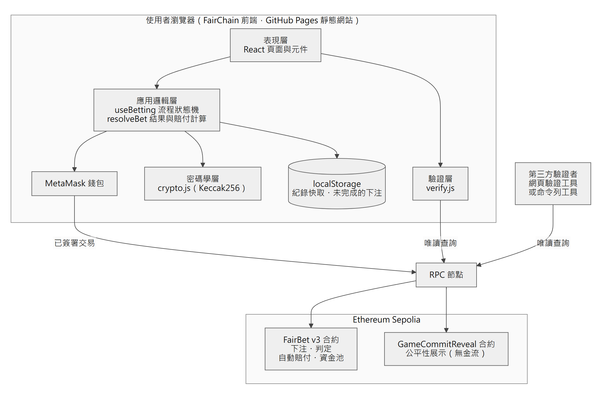
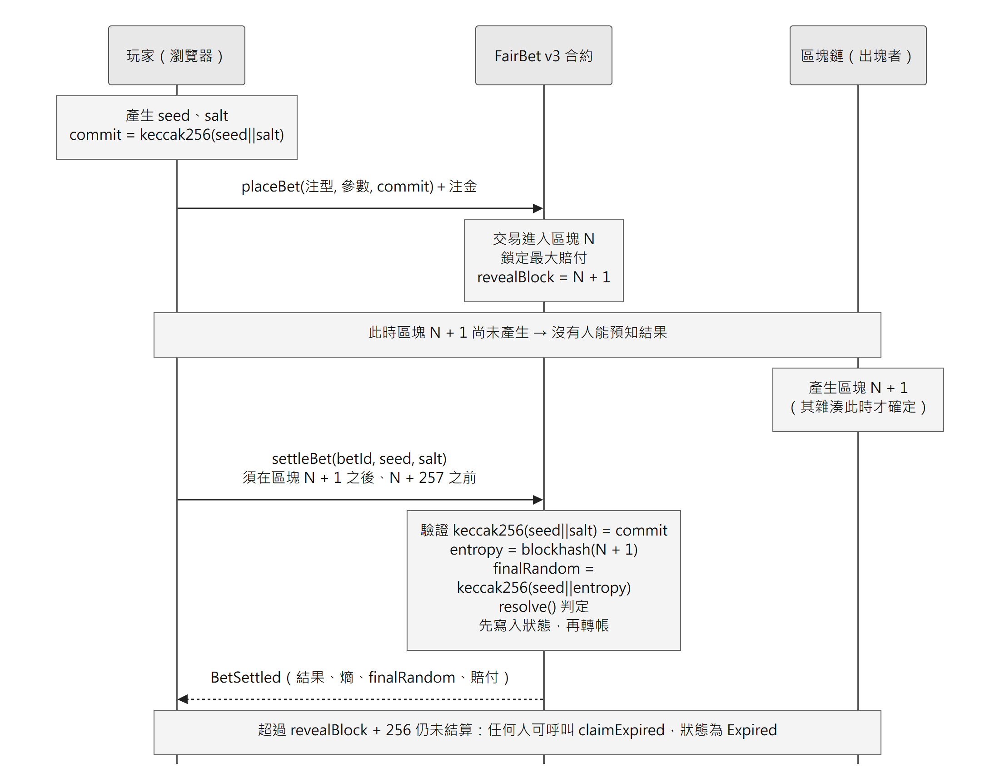
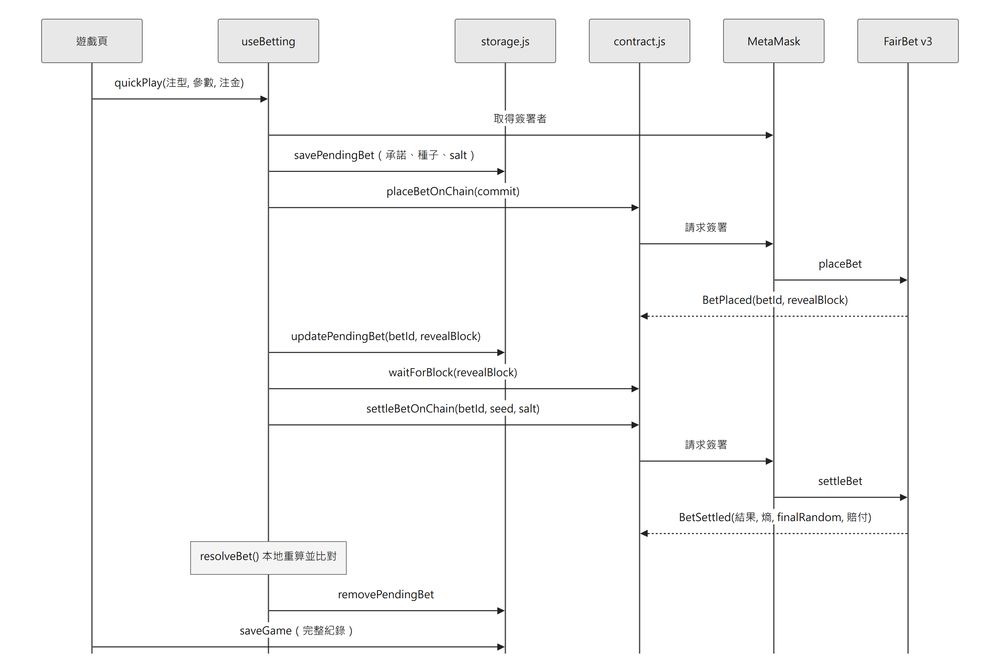
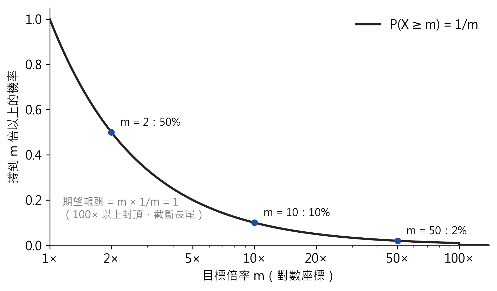
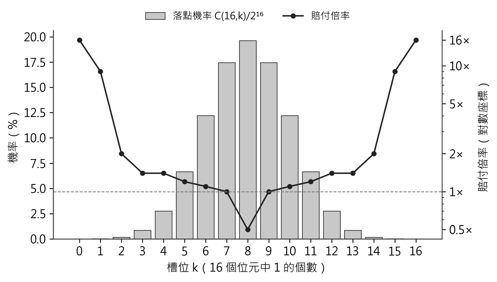
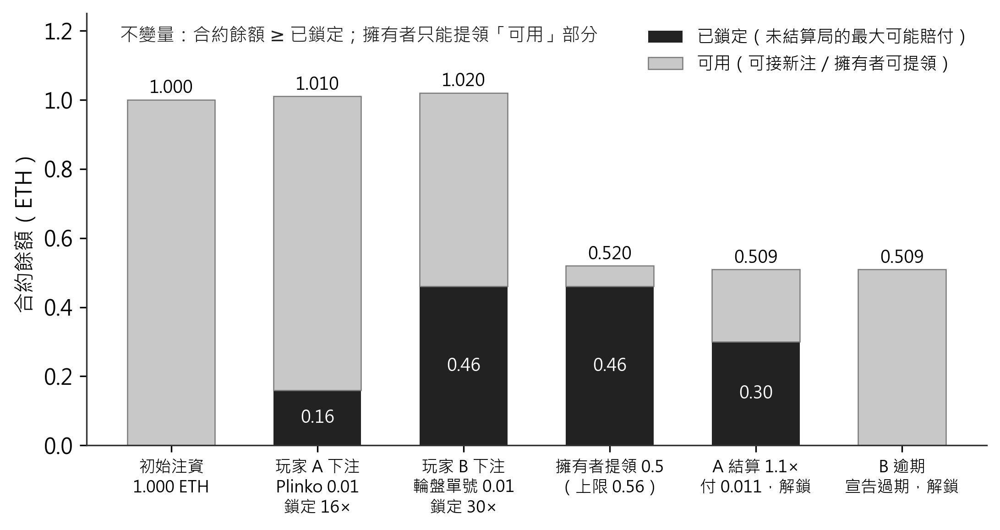
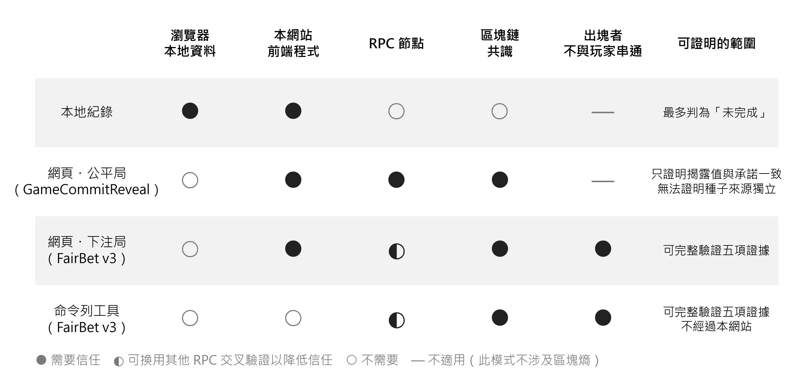
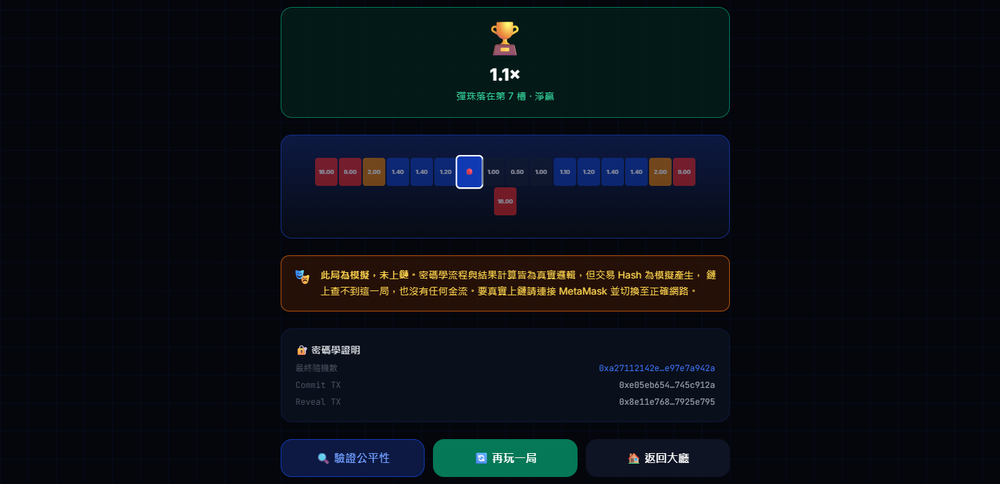
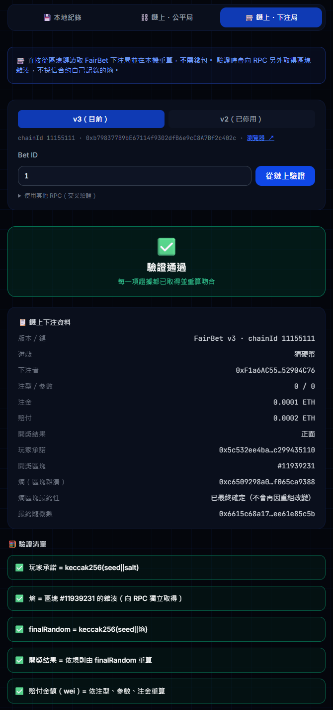

# 三、研究內容與方法

## 3.1 系統架構

### 3.1.1 架構設計原則

本系統採用**無後端伺服器（Serverless）架構**。此為刻意的設計決策：若保留傳統後端，則平台仍握有資料，信任問題並未真正消除。因此本系統將資料分為兩類並分別存放：

- **權威資料（Authoritative Data）**：承諾、種子、最終隨機數、下注金額、結算結果——全部儲存於**區塊鏈**，不可竄改且公開可讀。
- **便利性資料（Convenience Data）**：本機遊戲紀錄快取、介面偏好設定——儲存於瀏覽器 localStorage，僅供使用者體驗，**遺失不影響任何驗證能力**。

此劃分的意義在於：即使本系統網站完全下線、或本機資料全部清除，**任何人仍可從區塊鏈完整還原並驗證所有歷史遊戲**。

### 3.1.2 分層架構與職責

**表二 系統分層與職責**

| 層級 | 組成 | 職責 |
|---|---|---|
| 表現層 | React 元件、頁面路由 | 畫面渲染、使用者互動 |
| 應用邏輯層 | useBetting 流程狀態機、games/random.js 結果引擎、games/registry.js 遊戲註冊 | 遊戲流程控制、結果計算 |
| 密碼學層 | utils/crypto.js | 種子與 salt 生成、承諾計算與驗證 |
| 錢包層 | context/WalletContext.jsx | MetaMask 連線、網路切換、取得簽署者 |
| 鏈上互動層 | utils/contract.js | 封裝合約讀寫、提供唯讀 Provider |
| 區塊鏈層 | FairBet.sol、GameCommitReveal.sol | 收注、承諾驗證、結果判定、自動賠付、資金池管理 |

其中**鏈上互動層特別提供「唯讀 Provider」**：使用公開 RPC 節點而非使用者錢包，使第三方驗證者**無須安裝 MetaMask、無須擁有帳號**即可讀取鏈上資料進行驗證。此設計直接呼應研究目的三（無須許可之驗證）。



### 3.1.3 雙合約設計

本系統部署兩份智能合約，分工如下：

- **FairBet.sol（v3）**：完整的下注、判定與賠付，用於結果為 finalRandom 純函數的九種遊戲類型。亂數由玩家承諾與未來區塊雜湊組成（3.2 節）。
- **GameCommitReveal.sol**：無金流的公平性展示，用於二十一點與猜數字。其雙方種子皆由玩家端產生，合約僅能證明「揭露值與承諾一致」，**無法證明種子來源獨立**，玩家亦可於行動前算出牌堆或密碼；本研究不宣稱其具防作弊能力（限制見 4.7）。

此劃分體現了本研究的架構原則：**結果是否為純函數，決定了該遊戲能否上鏈結算**；而**是否存在隱藏資訊**，決定了單一隨機數能否支撐防作弊。

## 3.2 亂數協議設計：玩家承諾結合未來區塊雜湊

### 3.2.1 協議流程

設玩家為 P，下注交易被納入區塊 N。單局協議如下：

**階段一：下注與承諾**

1. P 於本機以密碼學安全亂數產生器產生 256 位元之種子 s 與盲化值 r，計算承諾 c = Keccak256(s ‖ r)。
2. 前端先將 (c, s, r, 注型) 寫入瀏覽器之「未完成下注」紀錄，再請 P 簽署 `placeBet(gameType, betType, param, c)` 並附帶注金。
3. 合約檢查注型合法、c 未曾使用、資金池足以支付最大賠付後，鎖定該賠付額，並記錄 **revealBlock = N + 1**。

**階段二：等待開獎區塊**

4. 前端輪詢直到鏈上最新區塊 ≥ revealBlock。**在 P 簽署下注之時，區塊 N+1 尚未存在。**

**階段三：揭露、判定與結算**

5. P 簽署 `settleBet(betId, s, r)`。合約檢查：呼叫者為該局玩家、revealBlock < 目前區塊 ≤ revealBlock + 256、Keccak256(s ‖ r) = c。
6. 合約取得熵 e = blockhash(revealBlock)，計算 finalRandom = Keccak256(s ‖ e)，以純函數 `resolve()` 求得結果與賠付。
7. 合約先將狀態改為 Settled，並將 s、r、e、finalRandom、結果與賠付寫入儲存區，最後才轉帳賠付。

**階段四：過期**

8. 若超過 revealBlock + 256 仍未結算，任何人可呼叫 `claimExpired`，該局狀態成為 **Expired**，注金留存資金池。結算與過期之有效區間互斥。

使用者每局簽署兩次；系統交易總數為兩筆（逾期時另加一筆任何人可送出的 `claimExpired`）。介面之「快速模式」僅連續送出兩筆交易，並非原子操作；若第二筆失敗，該局保留於未完成紀錄，重試時僅結算同一局。

圖二為協議層級的時序：玩家簽署下注時區塊 N+1 尚不存在，結算時合約才讀取其雜湊。圖三則是前端各模組在一局中的實際呼叫順序，包含送出前寫入未完成紀錄、等待開獎區塊與本地重算比對。





### 3.2.2 安全性論證

**（一）玩家無法預選結果。** finalRandom 取決於 e = blockhash(N+1)，而 P 簽署下注時區塊 N+1 尚未產生。P 能取得的最新資訊至多為區塊 N−1 之雜湊，以此預測者與實際結果無關（4.3 節以 40 局對抗測試驗證）。P 雖可於區塊 N+1 產生後算出結果並選擇不揭露，但注金已於下注時轉入合約，不揭露即等同輸掉，無法提高期望值。

**（二）出塊者單獨行動無法導向特定結果。** 區塊 N+1 之出塊者可藉調整區塊內容或棄塊影響 e，但不知 s，無法得知何種 e 對應何種結果。

**（三）殘餘風險：串通。** 若 P 將 s 告知出塊者，出塊者可篩選有利之區塊雜湊。此風險無法由本協議消除，其成本約為放棄該區塊之獎勵（2.4.4 節）。Slither 對 v3 回報之 `weak-prng` 警示即對應此風險（4.5 節）。高額情境宜改用 VRF，惟 VRF 亦有其服務可用性與確認數等安全考量（Chainlink Labs [22]），並非無條件更安全。

**（四）承諾不可事後更改且不可重用。** 由 Keccak256 之抗碰撞性，P 無法以另一組 (s', r') 通過承諾檢查；合約另以 `betIdByCommit` 禁止承諾重用，避免已公開之種子被再次使用。

**（五）最終性。** 前端於交易獲得一個確認後即顯示結果；若在 PoS 最終確定（約兩個 epoch，Ethereum Foundation [21]）之前發生區塊重組，revealBlock 可能被替換而改變結果。本研究尚未於介面區分「已確認」與「已最終確定」（列為限制）。

### 3.2.3 初版協議之缺陷與修正

初版（v2）之 `placeBet` 同時接收玩家承諾與「莊家」承諾，`settleBet` 亦由玩家同時提交雙方種子，finalRandom = Keccak256($s_P$ ‖ $s_D$)。由於系統無後端，兩個種子**均由玩家瀏覽器產生**，玩家可先算出 finalRandom 再選擇對應之注型。v2 另設一小時超時沒收，但該機制只處理下注後之中止，**對下注前之預選無效**。此缺陷經助教以本機對抗測試重現（連續三局全勝），v3 即依此修正，並將該反例納入永久回歸測試（4.3 節）。

### 3.2.4 前後端位元級等價

本系統的地基是以下等價關係：

```
前端：ethers.solidityPackedKeccak256(['bytes32','bytes32'], [a, b])
合約：keccak256(abi.encodePacked(a, b))
```

兩者皆為「將兩個 32 位元組值緊密串接後取 Keccak256」，**在位元層級完全相同**。此關係與結果引擎之一致性於第四章以測試實證。

## 3.3 遊戲結果引擎設計

### 3.3.1 核心約束：純函數原則

本研究提出的架構原則為：

  outcome = f(gameType, betType, param, finalRandom)

其中 f 必須是**純函數**——無外部狀態、無時間依賴、無玩家中途輸入。此約束帶來三項效益：

1. **合約可獨立判定**：無須信任前端回報的結果；
2. **第三方可驗證**：任何人給定相同輸入必得相同輸出；
3. **前後端可交叉驗證**：前端與合約各算一次，比對即可證明一致性。

此約束同時也是**限制**：含有玩家中途決策的遊戲（如二十一點的補牌選擇）無法滿足此條件，故僅能使用 GameCommitReveal 做公平性驗證，不支援鏈上結算。本研究認為誠實揭露此限制，比為求「全部上鏈」而扭曲遊戲規則更為重要。

### 3.3.2 固定倍率遊戲

**表三 固定倍率遊戲之結果映射與理論報酬率**

| 遊戲 | GameType | 結果計算 | 注型 | 中獎機率 | 賠率 | 理論 RTP |
|---|---|---|---|---|---|---|
| 骰子 | 0 | uint32(bytes4(fr)) % 6 + 1 | 大／小／單／雙 | 1/2 | 2 倍 | 100.00% |
| 猜硬幣 | 1 | uint32(bytes4(fr)) % 2 | 正／反 | 1/2 | 2 倍 | 100.00% |
| 輪盤 | 2 | uint32(bytes4(fr)) % 37 | 紅／黑／單／雙／大／小 | 18/37 | 2 倍 | 97.30% |
| 輪盤 | 2 | 同上 | 單一號碼 | 1/37 | 30 倍 | 81.08% |
| 拉霸 | 3 | 三段 bytes4 各 % 6 | 三同 | 6/216 | 8 倍 | 105.56% |
| 拉霸 | 3 | 同上 | 兩同 | 90/216 | 2 倍 | （合計） |

輪盤的 2 倍注型 RTP 為 (18/37)×2 ≈ 97.30%，此 1/37 的差額來自「0」號格，即傳統歐式輪盤的莊家優勢，本研究刻意保留以反映真實規則。

須誠實指出，**本系統各遊戲的賠率表並未統一校準至相同的莊家優勢**：輪盤單一號碼注型僅 81.08%（歐式輪盤標準應為 97.30%，對應 35 倍賠率，本系統設為 30 倍），而拉霸合計 RTP 達 105.56%（對玩家有利）。此為設計階段依直覺設定賠率所致，第四章將以蒙地卡羅實驗量化此偏差並於 4.7 節討論。由於本系統使用無價值之測試代幣，此偏差不影響研究結論之有效性，但在真實應用中必須修正。

### 3.3.3 變動倍率引擎

Solidity 不支援浮點數，故本研究採用**基點（basis points, bps）**表示倍率，1 倍 = 10000 bps：

  payout = floor(amount × multiplierBps / 10000)

整數除法的截斷誤差對玩家不利，但其量級為 1 wei（10 的 -18 次方 ETH），可忽略。

### 3.3.4 Crash／Limbo 倍率之數學推導

Crash 與 Limbo 共用同一倍率函數。設 h = uint256(fr) mod 2^52，E = 2^52，則：

  crashBps = min(10^6, floor(10000 × E / (E − h)))

**定理：** 若 h 在 [0, E) 上均勻分布，則崩盤倍率 X 滿足 P(X ≥ m) = 1/m。

**證明：** 倍率 X = E / (E − h)。則

  X ≥ m ⟺ E ≥ m(E − h) ⟺ h ≥ E(1 − 1/m)

由於 h 在 [0, E) 均勻分布，滿足此條件的 h 佔全體之比例為

  P(X ≥ m) = [E − E(1 − 1/m)] / E = 1/m  ∎

**推論（期望值）：** 玩家設定目標倍率 m，若 X ≥ m 則獲得 m 倍賠付，否則歸零。期望報酬為

  E[payout] = m × P(X ≥ m) = m × (1/m) = 1

即**理論 RTP 為 100%，無莊家優勢**。唯一的偏離來自 10^6 bps（100 倍）的上限截斷——當 m 大於 100 時無法達成，此上限的存在是為了保護資金池的償付能力。此設計使 Crash 成為本系統中數學上最「公平」的遊戲，亦成為驗證實作正確性的良好標的（見 4.5 節）。



### 3.3.5 Plinko 之機率分布

Plinko 模擬彈珠通過 16 層釘板，每層向左或向右等機率落下。本研究以**位元計數（popcount）**實作：

  k = popcount(uint256(fr) AND 0xFFFF)

取 finalRandom 的低 16 位元，計算其中「1」的個數 k（範圍 0 至 16），對應 17 個落點槽位。由於每個位元獨立且各為 1/2 機率，k 服從**二項分布 B(16, 1/2)**：

  P(k) = C(16, k) / 2^16

此實作的優點是**僅需位元運算而無迴圈**，Gas 成本為常數且遠低於逐層模擬。邊緣槽位（k=0 或 k=16）機率為 1/65536，故可設定高倍率；中央槽位（k=8）機率為 C(16,8)/2^16 約 19.6%，倍率設為低於 1 倍。



### 3.3.6 其他變動倍率遊戲

**幸運轉盤（Wheel）**：`uint256(fr) % 8` 對應 8 個扇區，倍率表為 [0, 1.8, 0, 1.5, 0, 2.5, 0, 1.2]，四個扇區歸零。理論 RTP 為 (0+1.8+0+1.5+0+2.5+0+1.2)/8 = 87.50%。由於 8 是 2 的冪次，**此取模無偏差**。

**左輪（Revolver）**：`uint256(fr) % 6` 決定彈膛位置；玩家選擇裝填子彈數 n（1 至 5），存活條件為 chamber ≥ n。存活機率為 (6−n)/6，合約倍率設為 `60000/(6−n)` bps 即 6/(6−n) 倍，故

  RTP = (6−n)/6 × 6/(6−n) = 1 = 100%

對 n = 1 至 5，`60000/(6−n)` 皆可整除（12000、15000、20000、30000、60000 bps），**無整數除法誤差**，五種注型的 RTP 皆精確為 100%。

## 3.4 智能合約安全機制

### 3.4.1 資金池鎖定（償付能力保證）

若合約接受了超出自身餘額所能賠付的下注，將導致「玩家獲勝但合約無錢支付」的違約。本研究於 placeBet 中實作前置檢查：

1. 呼叫 `maxPayout(gameType, betType, param, amount)` 計算該注可能的最大賠付；
2. 檢查 `address(this).balance >= lockedPayouts + maxPayout`；
3. 通過則將 maxPayout 累加至 lockedPayouts（鎖定）；
4. 結算或超時後從 lockedPayouts 扣除（解鎖）。

此機制**保證合約在任何時點皆有足夠餘額履行所有未結算的下注**，且 withdraw 函數亦受 lockedPayouts 限制，擁有者無法提領已鎖定的資金。

圖六以一組依合約規則計算的範例說明鎖定與解鎖：兩局下注分別鎖定 16 倍與 30 倍的最大賠付後，擁有者最多只能提領 0.56 ETH；結算與過期後鎖定額歸零。



### 3.4.2 揭露期限與過期狀態

期限以**區塊高度**計算而非時間戳：可結算區間為 revealBlock < 區塊 ≤ revealBlock + 256，可宣告過期區間為 > revealBlock + 256，兩者互斥，不存在「同一區塊兩者皆可執行、先到先贏」之競爭。256 之上限源於 EVM 僅能讀取最近 256 個區塊之雜湊。

過期局之狀態為獨立的 **Expired**，與正常結算之 Settled 區分，使驗證者不會將未開獎之局誤認為公平局。由於注金於下注時已轉入合約，拒絕揭露之代價即為損失全部注金，此即 Chatterjee 等人 [14] 所述押金懲罰機制之實作。

### 3.4.3 重入防護

合約於 settleBet 中嚴格遵循 **Checks-Effects-Interactions** 模式：

```
Checks:       驗證下注狀態、驗證兩個承諾
Effects:      設定 state = Settled、更新 lockedPayouts、寫入結果欄位
Interactions: 最後才執行 payable(player).call{value: payout}
```

由於狀態在轉帳前已更新為 Settled，即使接收方為惡意合約並於回呼中重入 settleBet，也會在狀態檢查處被拒絕。

### 3.4.4 存取控制與整數安全

- settleBet 僅限該注的玩家呼叫；claimExpired 任何人可呼叫；合約不存在任何能替玩家提交亂數的角色；
- withdraw 僅限合約擁有者，且受 lockedPayouts 限制；
- owner 宣告為 `immutable`（依 Slither 建議），部署後不可更改且節省 Gas；
- Solidity 0.8.24 內建整數溢位檢查，無須額外引入 SafeMath 函式庫。

## 3.5 驗證機制設計

**表四 驗證模式之比較**

| 模式 | 資料來源 | 需要錢包 | 需信任本系統 | 驗證內容 |
|---|---|---|---|---|
| 本地紀錄 | localStorage | 否 | 是 | 依遊戲分派：下注局重算承諾、finalRandom、結果與賠付；二十一點依補牌次數完整重播 |
| 鏈上・公平局 | GameCommitReveal | **否** | **否** | 承諾與 finalRandom 一致（不代表種子來源獨立） |
| 鏈上・下注局 | FairBet v3 | **否** | **否** | 承諾、熵、finalRandom、結果、賠付五項 |
| 命令列工具 | 任一 RPC | **否** | **否**（不經網站） | 同上 |

FairBet v3 將種子、熵與結果寫入儲存區，驗證者僅需一次 `getBet(betId)` 即取得全部證據，無須查詢歷史日誌（v2 之種子僅存於結算交易之 calldata，常因 RPC 限制日誌查詢而僅能部分驗證）。驗證流程為：

1. 讀取 `getBet(betId)`；
2. **另行**向 RPC 取得 revealBlock 之區塊雜湊，不採信合約自身記錄之熵；
3. 依序比對 Keccak256(s ‖ r) 與承諾、熵與區塊雜湊、Keccak256(s ‖ 區塊雜湊) 與 finalRandom、以 `resolveBet()` 重算之結果與賠付；
4. 任一項不符判為**失敗**；任一項無法取得證據判為**未完成**（不視為通過）；全部取得且吻合方判為**通過**；過期與未結算之局分別標示。

驗證工具可指定其他 RPC 交叉驗證並檢查 chainId；另提供不依賴網站之命令列工具 `scripts/verify-bet.mjs`。

各驗證模式所依賴的信任假設不同，整理如圖七：本地紀錄須信任瀏覽器資料，結論最多為「未完成」；公平局只能證明揭露值與承諾一致；下注局與命令列工具可完整驗證五項證據，且後者不經過本網站。



## 3.6 開發環境與技術選型

**表五 開發環境與技術選型**

| 類別 | 採用技術 | 版本 | 選用理由 |
|---|---|---|---|
| 前端框架 | React | 18 | 元件化、生態成熟 |
| 建置工具 | Vite | 5 | 開發啟動快、熱重載即時 |
| 樣式 | TailwindCSS | 3 | 樣式內聚於元件，避免全域 CSS 衝突 |
| 路由 | React Router | 6 | 單頁應用路由標準方案 |
| 動畫 | GSAP + ScrollTrigger | 3 | 支援捲動綁定與 reduced-motion 無障礙 |
| 區塊鏈函式庫 | ethers.js | **6** | v6 原生提供 solidityPackedKeccak256，與合約雜湊一致 |
| 智能合約語言 | Solidity | 0.8.24 | 0.8 以上內建溢位檢查 |
| 合約開發框架 | Hardhat | 2 | 本地鏈測試、gas reporter、部署腳本整合 |
| 前端測試 | Vitest | 2 | 與 Vite 共用設定 |
| 合約測試 | Hardhat + Chai | — | 業界標準；含安全回歸與 ABI 一致性 |
| 靜態分析 | Slither | 0.11.6 | Feist 等人 [10] 提出，涵蓋 102 項偵測器 |
| 部署鏈 | Ethereum Sepolia | chainId 11155111 | 官方測試網、水龍頭易取得、區塊瀏覽器支援完整 |
| 網站託管 | GitHub Pages + Actions | — | 免費、與版本控制整合、可自動部署 |

### 3.6.1 開發流程

本研究採用「合約先行、測試驅動」流程，並於持續整合中設置測試閘門：

1. 合約之 `resolve()` 與前端之 `resolveBet()` 實作相同公式；
2. 合約測試**直接載入前端之 `random.js`** 與 Solidity 比對，而非另寫一份 JavaScript 模型，確保測到的是前端實際執行之程式；
3. 另以測試檢查前端 ABI 與合約編譯產物一致；
4. 安全需求以**反例測試**表達（攻擊者做不到什麼），而不僅測試正確輸入能成功；
5. 推送至主分支時，CI 先執行前端與合約全部測試，任一失敗即停止部署；
6. 部署腳本於公開網路拒絕從含未提交修改之工作目錄部署，並將 commit、編譯設定、部署區塊寫入受版控之版本登錄表。

### 3.6.2 秘密管理

部署所需的私鑰與 RPC 端點置於 `contracts/.env`，該檔已列入 `.gitignore`，另提供 `.env.example` 供他人參考所需欄位。所有測試帳號僅持有無價值的測試代幣，**絕不存放真實資產**。前端建置產物於部署前皆檢查是否含有私鑰字串。

### 3.6.3 系統介面

圖八至圖十為系統主要介面。圖九為未連接錢包時的模擬模式畫面（流程與真實下注相同，但熵由本機產生、不上鏈）。圖十為線上網站的驗證工具，在未連接錢包的情況下直接從 Sepolia 讀取 FairBet v3 第 1 局並重算：畫面列出鏈上證據、五項驗證清單，以及熵所在區塊已最終確定。





