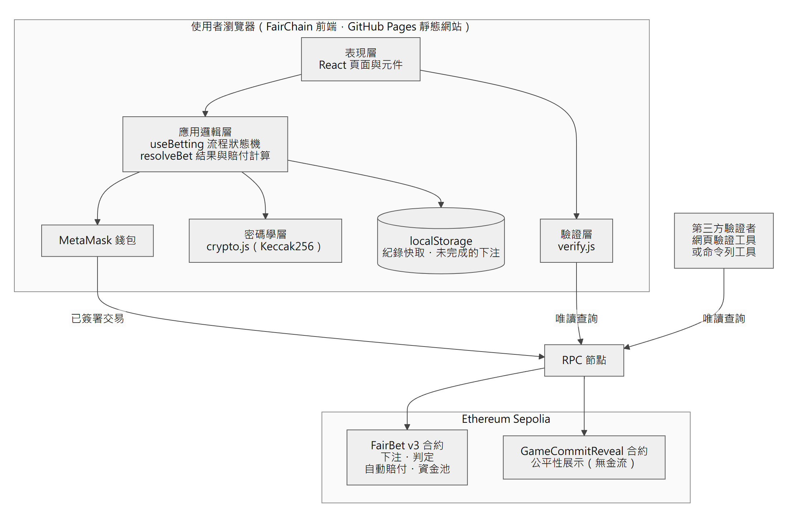
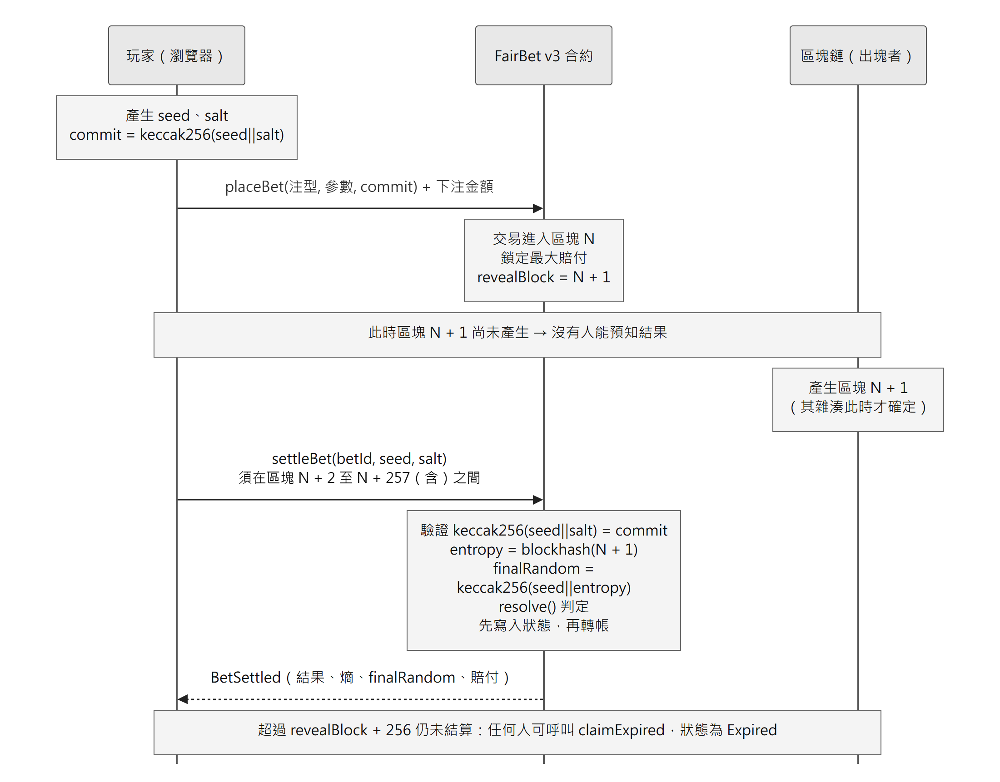
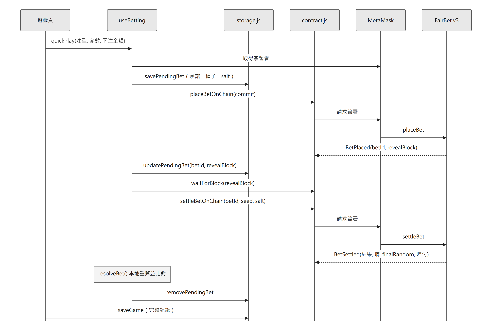
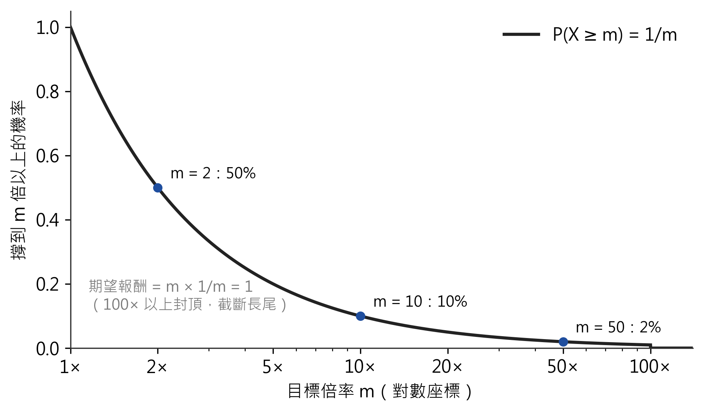
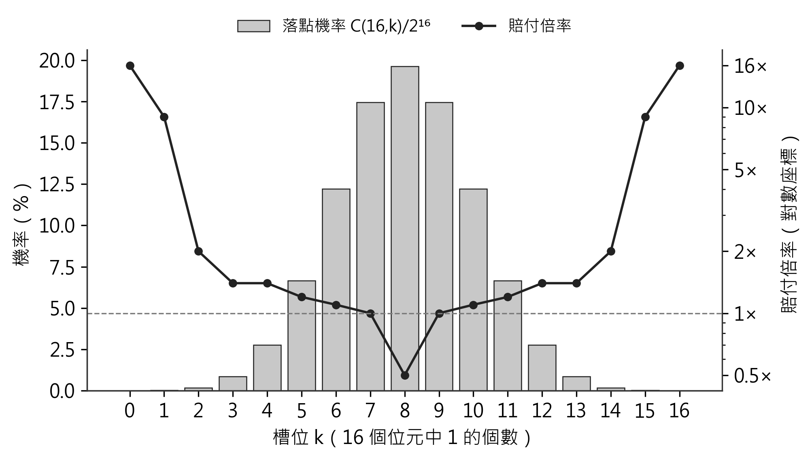
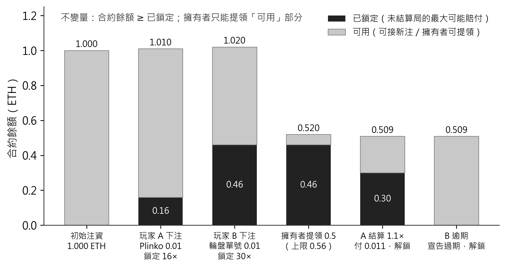
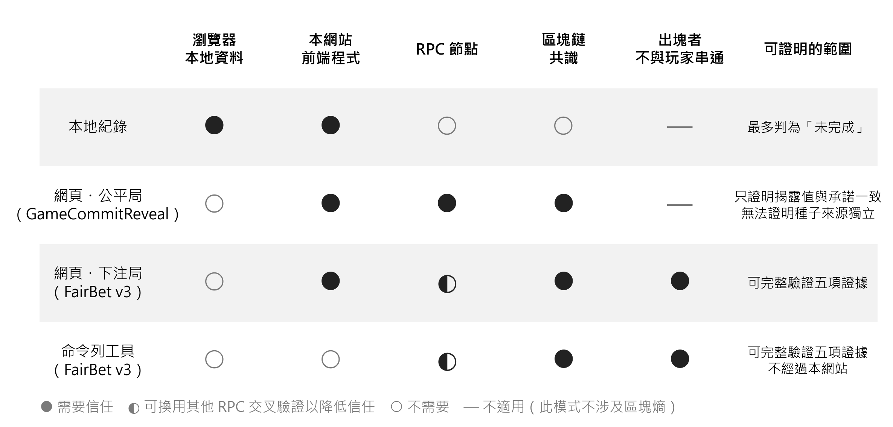
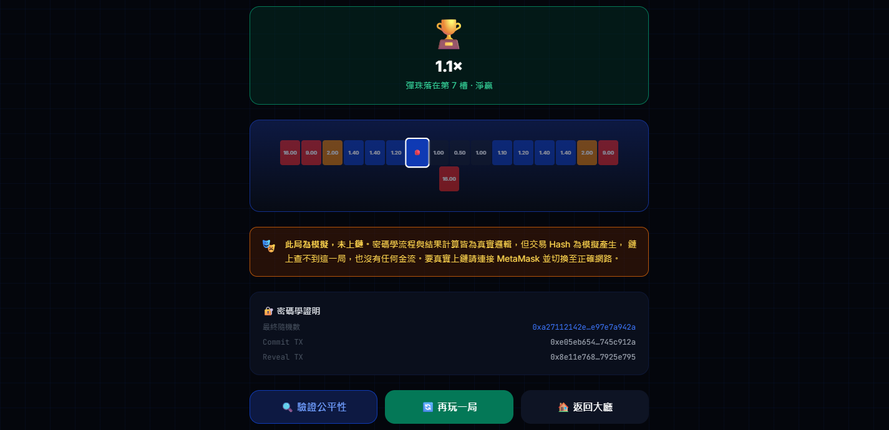
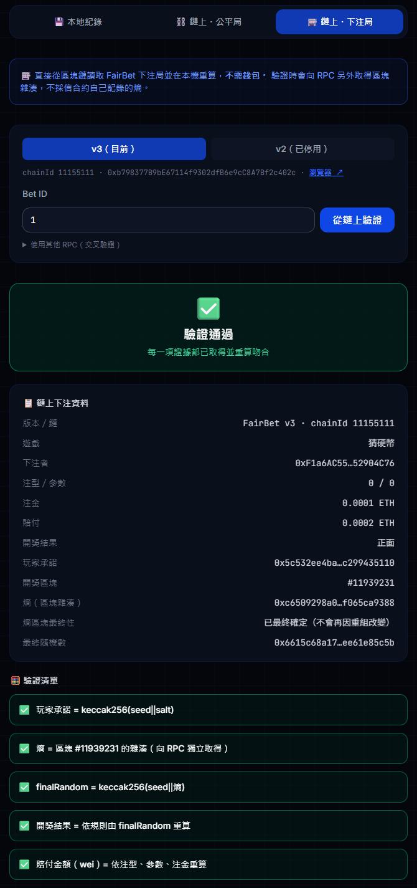

# 三、研究內容與方法

## 3.1 系統架構

### 3.1.1 架構設計原則

本系統採用靜態網頁前端、區塊鏈智能合約與外部 RPC 服務之架構，不另行建置自有應用程式後端或中心化遊戲資料庫（以下簡稱「無自建後端架構」）。此為刻意的設計決策：若保留傳統後端，則平台仍握有資料，信任問題並未真正消除。因此本系統將資料分為三類並分別存放：

- **權威資料（Authoritative Data）**：承諾與下注金額於下注時寫入區塊鏈，種子、最終隨機數與結算結果於結算時寫入；鏈上資料公開可讀，且於最終確定後難以竄改。
- **便利性資料（Convenience Data）**：本機遊戲紀錄快取、介面偏好設定——儲存於瀏覽器 localStorage，僅供使用者體驗，**遺失不影響已結算局之驗證**。
- **待結算之暫存秘密（Pending Secrets）**：未結算局之種子與盲化值——揭露前僅保存於玩家瀏覽器，遺失則該局無法結算，下注金額於期限後留存資金池（見 4.8.4）。

此劃分的意義在於：即使本系統網站完全下線、或本機資料全部清除，**已完成結算之局次仍可由任何人從公開鏈上資料完整驗證**。尚未結算之局次則受上述暫存秘密遺失之風險影響。

### 3.1.2 分層架構與職責

**表四 系統分層與職責**

| 層級 | 組成 | 職責 |
|---|---|---|
| 表現層 | React 元件、頁面路由 | 畫面呈現、使用者互動 |
| 應用邏輯層 | useBetting 流程狀態機、games/random.js 結果引擎、games/registry.js 遊戲註冊 | 遊戲流程控制、結果計算 |
| 密碼學層 | utils/crypto.js | 種子與盲化值生成、承諾計算與驗證 |
| 錢包層 | context/WalletContext.jsx | MetaMask 連線、網路切換、取得簽署者 |
| 鏈上互動層 | utils/contract.js | 封裝合約讀寫、提供唯讀 Provider |
| 區塊鏈層 | FairBet.sol、GameCommitReveal.sol | 收注、承諾驗證、結果判定、依規則賠付、資金池管理 |

資料來源：本專題整理

各層之組成與職責如表四，整體架構如圖一。其中**鏈上互動層特別提供「唯讀 Provider」**：使用公開 RPC 節點而非使用者錢包，使第三方驗證者**無須安裝 MetaMask、無須擁有帳號**即可讀取鏈上資料進行驗證。此設計直接呼應研究目的三（無須許可之驗證）。



資料來源：本專題繪製

### 3.1.3 雙合約設計

本系統部署兩份智能合約，分工如下：

- **FairBet.sol（v3）**：完整的下注、判定與賠付，用於結果可由公開下注參數與 finalRandom 確定性計算的九種遊戲類型。亂數由玩家承諾與未來區塊雜湊組成（3.2 節）。
- **GameCommitReveal.sol**：無金流的公平性展示，用於二十一點與猜數字。其雙方種子皆由玩家端產生，合約僅能證明「揭露值與承諾一致」，**無法證明種子來源獨立**，玩家亦可於行動前算出牌堆或密碼；本研究不宣稱其具防作弊能力（限制見 4.8.4）。

此劃分體現了本研究的架構原則：**結果是否為純函數**，決定了該遊戲能否以本系統之單次結算模式上鏈；而**是否存在隱藏資訊**，決定了單一隨機數能否支撐防作弊。

## 3.2 FairChain 亂數協議實作與修正

### 3.2.1 FairBet v2 之原始設計與缺陷

初版（v2）之 `placeBet` 同時接收玩家承諾與「莊家」承諾，`settleBet` 亦由玩家同時提交雙方種子，finalRandom = Keccak256($s_P$ ‖ $s_D$)。由於系統無自建後端，兩個種子**均由玩家瀏覽器產生**，玩家可先算出 finalRandom 再選擇對應之注型。v2 另設一小時超時沒收，但該機制只處理下注後之中止，**對下注前之預選無效**。此缺陷由助教以本機對抗測試指出並重現（連續三局全勝），v3 即依此修正，並將該反例納入永久回歸測試（4.3 節）。

### 3.2.2 FairBet v3 之修改內容

FairBet v3 參考第二章所介紹之「種子承諾結合未來區塊雜湊」既有方法（Volland [29]、Reutov [31]，見 2.4.4），依 FairChain 無自建後端之需求改由玩家本人承諾種子。相較於 v2 之修改如表五；合約之修改見本專題專案 git commit 0411eda，前端之對應修改見 6c99f46。

**表五　FairBet v2 與 v3 之比較**

| 比較項目 | FairBet v2 | FairBet v3 |
|---|---|---|
| 亂數來源 | 玩家端產生玩家與「莊家」兩份種子，finalRandom = Keccak256(sP ‖ sD) | 玩家提供一份種子；第二份熵取自下注後才產生之區塊雜湊，finalRandom = Keccak256(s ‖ blockhash(revealBlock)) |
| 下注前能否算出結果 | 能（兩份種子皆在玩家手中） | 在 3.2.4 之假設 A1–A3 下不能 |
| placeBet 之輸入 | 玩家承諾與「莊家」承諾 | 僅玩家承諾；合約記錄 revealBlock = N + 1 |
| 結算 | 玩家同時提交雙方種子 | settleBet(betId, seed, salt)，限該局玩家，且須於 revealBlock 之後 256 個區塊內 |
| 逾期處理 | 一小時超時沒收（以時間戳計算） | 以區塊高度計算；claimExpired() 將該局設為獨立之 Expired 狀態 |
| 驗證證據 | 種子僅存於結算交易之 calldata | 種子、盲化值、熵、finalRandom、結果與賠付寫入儲存區，getBet() 一次取得 |
| 程式與分工 | FairBet.sol（git commit 2076ee1） | FairBet.sol（git commit 0411eda）；缺陷由助教指出，修正之程式撰寫與測試由吳宜謙完成（AI 工具協助，見 2.7） |

資料來源：本專題整理（contracts/contracts/FairBet.sol 與 git 版本紀錄）

### 3.2.3 承諾、揭露與結算之函式實作

以下依 FairBet v3 之函式說明單局流程。設玩家為 P，下注交易被納入區塊 N：

**階段一：下注與承諾（placeBet）**

1. P 於本機以密碼學安全亂數產生器產生 256 位元之種子 s 與盲化值 r，計算承諾 c = Keccak256(s ‖ r)。
2. 前端先將 (c, s, r, 注型) 寫入瀏覽器之「未完成下注」紀錄，再請 P 簽署 `placeBet(gameType, betType, param, c)` 並附帶下注金額。
3. 合約檢查注型合法、c 未曾使用、資金池足以支付最大賠付後，鎖定該賠付額，並記錄 **revealBlock = N + 1**。

**階段二：等待開獎區塊**

4. 前端輪詢直到鏈上最新區塊 ≥ revealBlock。**在 P 簽署下注之時，區塊 N+1 尚未存在。**

**階段三：揭露、判定與結算（settleBet）**

5. P 簽署 `settleBet(betId, s, r)`。合約檢查：呼叫者為該局玩家、revealBlock < 目前區塊 ≤ revealBlock + 256、Keccak256(s ‖ r) = c。
6. 合約取得熵 e = blockhash(revealBlock)，計算 finalRandom = Keccak256(s ‖ e)，以純函數 `resolve()` 求得結果與賠付。
7. 合約先將狀態改為 Settled，並將 s、r、e、finalRandom、結果與賠付寫入儲存區，最後才轉帳賠付。

**階段四：過期（claimExpired）**

8. 若超過 revealBlock + 256 仍未結算，任何人可呼叫 `claimExpired`，該局狀態成為 **Expired**，下注金額留存資金池。結算與過期之有效區間互斥。

使用者每局簽署兩次；系統交易總數為兩筆（逾期時另加一筆任何人可送出的 `claimExpired`）。介面之「快速模式」僅連續送出兩筆交易，並非原子操作；若第二筆失敗，該局保留於未完成紀錄，重試時僅結算同一局。

圖二為協議層級的時序：玩家簽署下注時區塊 N+1 尚不存在，結算時合約才讀取其雜湊。圖三則是前端各模組在一局中的實際呼叫順序，包含送出前寫入未完成紀錄、等待開獎區塊與本地重算比對。



資料來源：本專題繪製



資料來源：本專題繪製

### 3.2.4 安全假設與限制

以下論證成立於三項假設：（A1）玩家之種子與盲化值於揭露前未洩漏；（A2）玩家簽署下注時無法得知區塊 N+1 之雜湊；（A3）玩家不與區塊 N+1 之出塊者串通。論證不涵蓋交易排序（如搶先交易，Eskandari 等人 [18]）、區塊重組與拒絕揭露之情形，分別於（三）、（五）與 3.4.2 討論。4.3 節之 40 局對抗測試僅顯示在測試設定下未重現初版之預選攻擊，並非數學安全證明。

**（一）在 A1–A3 下，玩家無法預選結果。** finalRandom 取決於 e = blockhash(N+1)，而 P 簽署下注時區塊 N+1 尚未產生。P 能取得的最新資訊至多為區塊 N−1 之雜湊，以此預測者與實際結果無關（4.3 節之 40 局對抗測試未重現初版攻擊）。P 雖可於區塊 N+1 產生後算出結果並選擇不揭露，但下注金額已於下注時轉入合約，不揭露即等同輸掉，無法提高期望值。

**（二）出塊者單獨行動無法導向特定結果。** 區塊 N+1 之出塊者可藉調整區塊內容或棄塊影響 e，但不知 s，無法得知何種 e 對應何種結果。

**（三）殘餘風險：串通。** 若 P 將 s 告知出塊者，出塊者可篩選有利之區塊雜湊。此風險無法由本協議消除，其成本與可行性見 2.4.4 節之討論。Slither 對 v3 回報之 `weak-prng` 警示即對應此風險（4.5 節）。高額情境宜改用 VRF，惟 VRF 亦有其服務可用性與確認數等安全考量（Chainlink Labs [22]），並非無條件更安全。

**（四）承諾不可事後更改且不可重用。** 由 Keccak256 之抗碰撞性，P 無法以另一組 (s', r') 通過承諾檢查；合約另以 `betIdByCommit` 禁止承諾重用，避免已公開之種子被再次使用。

**（五）最終性。** 前端於交易獲得一個確認後即顯示結果；若在 PoS 最終確定（約兩個 epoch，Ethereum Foundation [21]）之前發生區塊重組，revealBlock 可能被替換而改變結果。前端已於結果頁與驗證工具分開標示「已確認」與「已最終確定」（4.7.1），但重組實際發生時不會自動重新結算（列為限制，4.8.4）。

### 3.2.5 前後端位元級等價

本系統的地基是以下等價關係：

```
前端：ethers.solidityPackedKeccak256(['bytes32','bytes32'], [a, b])
合約：keccak256(abi.encodePacked(a, b))
```

兩者皆為「將兩個 32 位元組值緊密串接後取 Keccak256」，**在位元層級完全相同**。此關係與結果引擎之一致性於第四章以測試實證。

## 3.3 遊戲結果引擎設計

### 3.3.1 結果函數之輸入與判準

本系統將每一局之結果寫成確定性函數（純函數之概念見 2.1.2）：

  outcome = f(gameType, betType, param, finalRandom)

其中 gameType、betType、param 為下注時寫入鏈上之公開參數，finalRandom 為開獎亂數；f 不讀取外部狀態與時間，亦不接受玩家中途輸入。f 於前端實作為 `src/games/random.js` 之 `resolveBet()`，於合約實作為 `resolve()`，兩者以相同公式撰寫，一致性以 4.2 節之測試驗證。依此判準：

1. 合約可自行重算結果與賠付，不採信前端回報；
2. 第三方以鏈上之公開參數與 finalRandom 即可重算；
3. 前端與合約各算一次並比對，可檢查兩者之實作一致。

此判準同時界定了本系統之設計範圍：FairBet v3 採用單次取得 finalRandom、以公開下注參數一次結算之模式，尚未設計二十一點等需要中途決策及隱藏資訊之多階段鏈上狀態機，因此二十一點與猜數字在本專題中僅以 GameCommitReveal 展示部分公平性驗證。此為本系統之設計範圍，並非此類遊戲在技術上不能鏈上結算。

### 3.3.2 固定倍率遊戲

**表六 固定倍率遊戲之結果映射與理論報酬率**

| 遊戲 | 類型代碼 | 結果計算 | 注型 | 中獎機率 | 賠率 | 理論 RTP |
|---|---|---|---|---|---|---|
| 骰子 | 0 | uint32(bytes4(fr)) mod 6 + 1 | 大／小／單／雙 | 1/2 | 2 倍 | 100.00% |
| 猜硬幣 | 1 | uint32(bytes4(fr)) mod 2 | 正／反 | 1/2 | 2 倍 | 100.00% |
| 輪盤 | 2 | uint32(bytes4(fr)) mod 37 | 紅／黑／單／雙／大／小 | 18/37 | 2 倍 | 97.30% |
| 輪盤 | 2 | 同上 | 單一號碼 | 1/37 | 30 倍 | 81.08% |
| 拉霸 | 3 | 三段 bytes4 各 mod 6 | 三同 | 6/216 | 8 倍 | 105.56% |
| 拉霸 | 3 | 同上 | 兩同 | 90/216 | 2 倍 | （合計） |

資料來源：本專題依合約規則計算

各固定倍率遊戲之結果映射與理論返還率（Return to Player, RTP）如表六。輪盤的 2 倍注型 RTP 為 (18/37)×2 ≈ 97.30%，此 1/37 的差額來自「0」號格，即傳統歐式輪盤的莊家優勢，本研究刻意保留以反映真實規則。

須誠實指出，**本系統各遊戲的賠率表並未統一校準至相同的莊家優勢**：輪盤單一號碼注型僅 81.08%（歐式輪盤標準應為 97.30%，對應 35 倍賠率，本系統設為 30 倍），而拉霸合計 RTP 達 105.56%（對玩家有利）。此為設計階段依直覺設定賠率所致，第四章將以蒙地卡羅實驗量化此偏差並於 4.8.3 節討論。由於本系統使用無價值之測試代幣，此偏差不影響研究結論之有效性，但在真實應用中必須修正。

### 3.3.3 變動倍率引擎

Solidity 不支援浮點數，故本研究採用**基點（basis points, bps）**表示倍率，1 倍 = 10000 bps：

  payout = floor(amount × multiplierBps / 10000)

整數除法的截斷誤差對玩家不利，但其量級為 1 wei（10 的 -18 次方 ETH），可忽略。

### 3.3.4 Crash／Limbo 倍率之實作

本系統採用 2.6.2 所述之 Crash 倍率形式（bustabit [33]），並作三項修改：去除 1% 莊家優勢、改以整數 bps 運算、設 100 倍上限。程式位於合約之 `crashBps()` 與前端 `src/games/random.js` 之 `crashBps()`，兩者以相同公式撰寫：

Crash 與 Limbo 共用同一倍率函數。設 h = uint256(fr) mod 2^52，E = 2^52，則：

  crashBps = min(10^6, floor(10000 × E / (E − h)))

依 2.6.2 之理想化模型，未截斷時 P(X ≥ m) = 1/m、理論 RTP 為 100%。本實作以整數方式計算倍率，與理想化連續模型之間尚有離散取值與整數截斷帶來之細微差異；此外，100 倍（10^6 bps）上限亦限制可達倍率：目標倍率大於 100 倍時無法達成，此上限用以保護資金池之償付能力。圖四為本實作之分布函數示意，第四章以模擬結果檢查實際分布（4.6.4）。



資料來源：本專題依本系統之倍率實作繪製（倍率形式參考 bustabit [33]）

### 3.3.5 Plinko 之實作

本系統之 Plinko 採 16 層釘板，依 2.6.3 之二項模型，以**位元計數（popcount）**取代逐層模擬：

  k = popcount(uint256(fr) AND 0xFFFF)

取 finalRandom 的低 16 位元，計算其中「1」的個數 k（範圍 0 至 16），對應 17 個落點槽位；由於各位元獨立且各為 1/2 機率，k 即服從 2.6.3 所述之 B(16, 1/2)。

此實作的優點是**僅需位元運算而無迴圈**，Gas 成本為常數且遠低於逐層模擬。邊緣槽位（k=0 或 k=16）機率為 1/65536，故可設定高倍率；中央槽位（k=8）機率為 C(16,8)/2^16 約 19.6%，倍率設為低於 1 倍。圖五對照各槽位之機率與倍率。



資料來源：本專題繪製

### 3.3.6 其他變動倍率遊戲

**幸運轉盤（Wheel）**：`uint256(fr) mod 8` 對應 8 個扇區，倍率表為 [0, 1.8, 0, 1.5, 0, 2.5, 0, 1.2]，四個扇區歸零。理論 RTP 為 (0+1.8+0+1.5+0+2.5+0+1.2)/8 = 87.50%。由於 8 是 2 的冪次，**此取模無偏差**。

**左輪（Revolver）**：`uint256(fr) mod 6` 決定彈膛位置；玩家選擇裝填子彈數 n（1 至 5），存活條件為 chamber ≥ n。存活機率為 (6−n)/6，合約倍率設為 `60000/(6−n)` bps 即 6/(6−n) 倍，故

  RTP = (6−n)/6 × 6/(6−n) = 1 = 100%

對 n = 1 至 5，`60000/(6−n)` 皆可整除（12000、15000、20000、30000、60000 bps），**無整數除法誤差**，五種注型的 RTP 皆精確為 100%。

### 3.3.7 二十一點洗牌之實作

二十一點僅作公平性展示（3.1.3），其牌堆由 finalRandom 決定，實作於 `src/utils/gameLogic.js`，採用 2.6.1 所述之 Fisher-Yates 洗牌與拒絕採樣：

本系統初期實作直接消耗 finalRandom 的 32 個位元組作為索引來源，但 52 張牌需要 51 次隨機索引，導致位元組重複使用而破壞獨立性。第二版改用 Xorshift 偽隨機數生成器 [11]，以 finalRandom 種子化後產生所需長度之序列；然而其起始狀態僅由 finalRandom 之兩段 32 位元 XOR 而得，有效熵至多約 2^32，遠小於 52! ≈ 2^225.6 種排列——「週期足夠長」並不代表「可能產生的牌堆足夠多」。現行版本改以 Keccak256(finalRandom ‖ 計數器) 產生 32 位元串流，並以拒絕採樣取得無偏之索引（Lemire [12] 所討論之區間映射問題），使有效熵為 finalRandom 的完整 256 位元。舊紀錄以版本欄位區分，仍可依原演算法驗證。

## 3.4 智能合約安全機制

### 3.4.1 資金池鎖定（償付能力保證）

本系統採用 2.5.3 所述之賠付鎖定作法（Dice2Win [30]），以狀態變數 `lockedPayouts` 記錄所有未結算下注之最大賠付總和，並於 `placeBet()` 中依序執行：

1. 呼叫 `maxPayout(gameType, betType, param, amount)` 計算該注可能的最大賠付；
2. 檢查 `address(this).balance >= lockedPayouts + maxPayout`；
3. 通過則將 maxPayout 累加至 lockedPayouts（鎖定）；
4. settleBet() 或 claimExpired() 時，自 lockedPayouts 扣回該局之最大賠付（解鎖）。

`withdraw()` 僅允許提領 address(this).balance − lockedPayouts 之部分，故合約在任何時點皆保有足夠餘額履行所有未結算之下注，擁有者亦無法提領已鎖定之資金。

圖六以一組依合約規則計算的範例說明鎖定與解鎖：兩局下注分別鎖定 16 倍與 30 倍的最大賠付後，擁有者最多只能提領 0.56 ETH；結算與過期後鎖定額歸零。



資料來源：本專題繪製

### 3.4.2 揭露期限與過期狀態

期限以**區塊高度**計算而非時間戳：可結算區間為 revealBlock < 區塊 ≤ revealBlock + 256，可宣告過期區間為 > revealBlock + 256，兩者互斥，不存在「同一區塊兩者皆可執行、先到先贏」之競爭。256 之上限源於 EVM 僅能讀取最近 256 個區塊之雜湊 [29][31]。

`claimExpired()` 僅在區塊高度超過 revealBlock + 256 且該局仍為 Placed 時可執行，任何人皆可呼叫；執行後扣回該局之鎖定額、將狀態設為 Expired 並發出 BetExpired 事件，下注金額留存資金池。Expired 與正常結算之 Settled 分開，使驗證者不會將未開獎之局誤認為公平局。此即採用 2.3.3 所述之押金懲罰 [14]：拒絕揭露之代價為損失全部下注金額；與 Dice2Win [30] 由莊家揭露、逾期退還玩家不同，本系統之揭露者為玩家本人，故逾期不退還。

### 3.4.3 重入防護

`settleBet()` 依 2.5.3 所述之 Checks-Effects-Interactions 模式 [19] 排列程式：

```
Checks:       驗證下注狀態、呼叫者、揭露期限與玩家承諾
Effects:      設定 state = Settled、更新 lockedPayouts、寫入結果欄位
Interactions: 最後才執行 msg.sender.call{value: payout}（msg.sender 已檢查為該局玩家）
```

由於狀態在轉帳前已更新為 Settled，即使接收方為惡意合約並於回呼中重入 settleBet，也會在狀態檢查處被拒絕；對應之測試以惡意收款合約 contracts/test/PlayerProxy.sol 驗證（4.3.2）。

### 3.4.4 存取控制與整數安全

- settleBet 僅限該注的玩家呼叫，因此他人即使於記憶池（mempool）中看見揭露之種子，亦無法搶先代為結算（搶先交易之分類見 Eskandari 等人 [18]）；claimExpired 任何人可呼叫；合約不存在任何能替玩家提交亂數的角色；
- withdraw 僅限合約擁有者，且受 lockedPayouts 限制；
- owner 宣告為 `immutable`（依 Slither 建議），部署後不可更改且節省 Gas；
- Solidity 0.8.24 內建整數溢位檢查，無須額外引入 SafeMath 函式庫。

## 3.5 驗證機制設計

**表七 驗證模式之比較**

| 模式 | 資料來源 | 需要錢包 | 需信任本系統 | 驗證內容 |
|---|---|---|---|---|
| 本地紀錄 | localStorage | 否 | 是 | 依遊戲分派：下注局重算承諾、finalRandom、結果與賠付；二十一點依補牌次數完整重播 |
| 鏈上・公平局 | GameCommitReveal | **否** | **否** | 承諾與 finalRandom 一致（不代表種子來源獨立） |
| 鏈上・下注局 | FairBet v3 | **否** | **否** | 承諾、熵、finalRandom、結果、賠付五項 |
| 命令列工具 | 任一 RPC | **否** | **否**（不經網站） | 同上 |

資料來源：本專題整理

表七比較各驗證模式之資料來源與信任假設。FairBet v3 將種子、熵與結果寫入儲存區，驗證者僅需一次 `getBet(betId)` 即取得全部證據，無須查詢歷史日誌（v2 之種子僅存於結算交易之 calldata，常因 RPC 限制日誌查詢而僅能部分驗證）。驗證流程為：

1. 讀取 getBet(betId)；
2. 另行向 RPC 取得 revealBlock 之區塊雜湊，不採信合約自身記錄之熵；
3. 依序核對五項證據：（1）承諾：重算 Keccak256(s ‖ r) 並比對鏈上承諾；（2）區塊熵：比對合約記錄之熵與另行取得之區塊雜湊；（3）最終隨機數：重算 Keccak256(s ‖ 區塊雜湊) 並比對 finalRandom；（4）結果：以 resolveBet() 依下注參數與 finalRandom 重算；（5）賠付：依遊戲規則與下注金額重算並比對 payout；
4. 任一項不符判為失敗；任一項無法取得證據判為未完成（不視為通過）；全部取得且吻合方判為通過；過期與未結算之局分別標示。

判定邏輯實作於 `src/utils/verify.js`（不含網路存取，可單獨測試），鏈上讀取與區塊雜湊查詢實作於 `src/utils/contract.js`，網站之驗證頁面為 `src/pages/Verifier.jsx`；判定結果分為通過、失敗、未完成、已過期與未結算五種（verified／failed／incomplete／expired／pending）。驗證工具可指定其他 RPC 交叉驗證並檢查 chainId；另提供不依賴網站之命令列工具 `scripts/verify-bet.mjs`，重用同一判定邏輯。

各驗證模式所依賴的信任假設不同，整理如圖七：本地紀錄須信任瀏覽器資料，結論最多為「未完成」；公平局只能證明揭露值與承諾一致；下注局與命令列工具可完整驗證五項證據，且後者不經過本網站。



資料來源：本專題繪製

## 3.6 開發環境與技術選型

本系統採用之技術、版本與選用理由如表八。

**表八 開發環境與技術選型**

| 類別 | 採用技術 | 版本 | 選用理由 |
|---|---|---|---|
| 前端框架 | React | 18 | 元件化、生態成熟 |
| 建置工具 | Vite | 5 | 開發啟動快、熱重載即時 |
| 樣式 | TailwindCSS | 3 | 樣式內聚於元件，避免全域 CSS 衝突 |
| 路由 | React Router | 6 | 單頁應用路由標準方案 |
| 動畫 | GSAP + ScrollTrigger | 3 | 支援捲動綁定與 reduced-motion 無障礙 |
| 區塊鏈函式庫 | ethers.js | **6** | v6 原生提供 solidityPackedKeccak256，與合約雜湊一致 |
| 智能合約語言 | Solidity | 0.8.24 | 0.8 以上內建溢位檢查 |
| 合約開發框架 | Hardhat | 2 | 本地鏈測試、gas reporter、部署腳本整合 |
| 前端測試 | Vitest | 2 | 與 Vite 共用設定 |
| 合約測試 | Hardhat + Chai | — | 業界標準；含安全回歸與 ABI 一致性 |
| 靜態分析 | Slither | 0.11.6 | Feist 等人 [10] 提出，涵蓋 102 項偵測器 |
| 部署鏈 | Ethereum Sepolia | chainId 11155111 | 官方測試網、水龍頭易取得、區塊瀏覽器支援完整 |
| 網站託管 | GitHub Pages + Actions | — | 免費、與版本控制整合、可自動部署 |

資料來源：本專題整理。React、Vite、TailwindCSS、React Router、GSAP、ethers.js、Hardhat、Chai、Vitest 均為開放原始碼套件，本專題僅使用其公開介面；Solidity 與 ethers.js 文件見 [19][20]，Slither 見 [10]。

### 3.6.1 開發流程

本研究採用「合約先行、測試驅動」流程，並於持續整合中設置測試閘門：

1. 合約之 `resolve()` 與前端之 `resolveBet()` 實作相同公式；
2. 合約測試**直接載入前端之 `random.js`** 與 Solidity 比對，而非另寫一份 JavaScript 模型，確保測到的是前端實際執行之程式；
3. 另以測試檢查前端 ABI 與合約編譯產物一致；
4. 安全需求以**反例測試**表達（攻擊者做不到什麼），而不僅測試正確輸入能成功；
5. 推送至主分支時，CI 先執行前端與合約全部測試，任一失敗即停止部署；
6. 部署腳本於公開網路拒絕從含未提交修改之工作目錄部署，並將 commit、編譯設定、部署區塊寫入受版控之版本登錄表。

### 3.6.2 秘密管理

部署所需的私鑰與 RPC 端點置於 `contracts/.env`，該檔已列入 `.gitignore`，另提供 `.env.example` 供他人參考所需欄位。所有測試帳號僅持有無價值的測試代幣，**絕不存放真實資產**。前端建置產物於部署前皆檢查是否含有私鑰字串。

### 3.6.3 系統介面

圖八至圖十為系統主要介面。圖九為未連接錢包時的模擬模式畫面（流程與真實下注相同，但熵由本機產生、不上鏈）。圖十為線上網站的驗證工具，在未連接錢包的情況下直接從 Sepolia 讀取 FairBet v3 第 1 局並重算：畫面列出鏈上證據、五項驗證清單，以及熵所在區塊已最終確定。


資料來源：本專題系統畫面截圖



資料來源：本專題系統畫面截圖



資料來源：本專題系統畫面截圖
