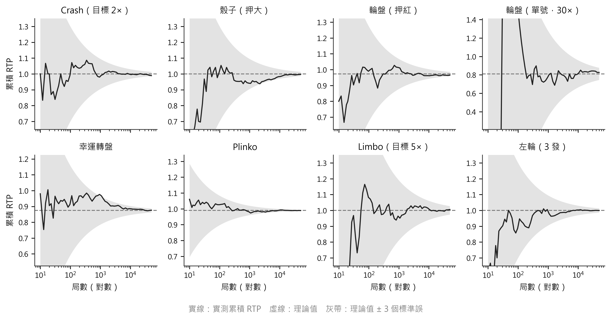
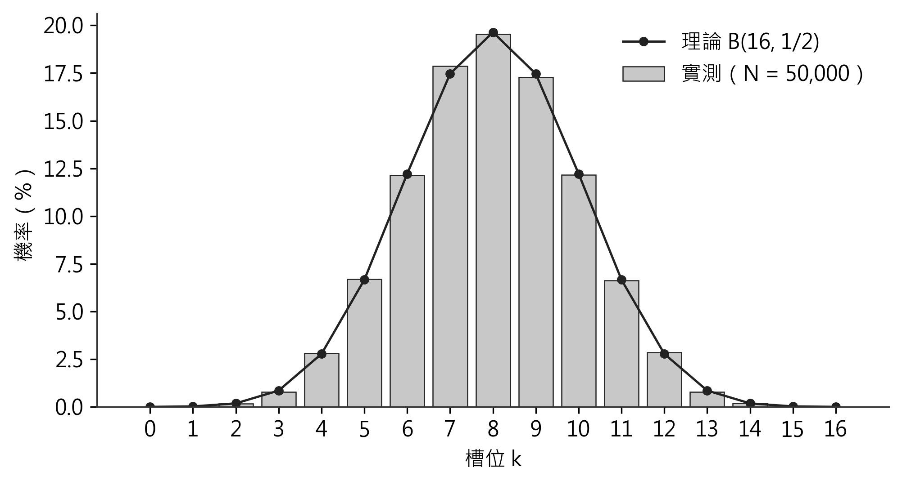
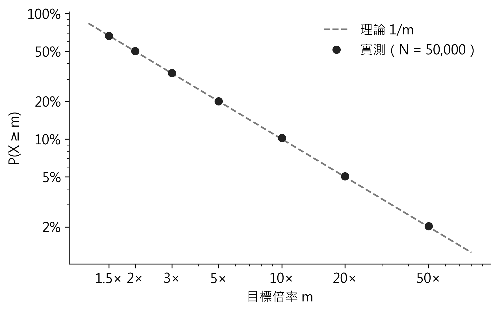

# 四、實驗討論

本章以六組實驗檢驗系統的正確性、安全性、效能與公平性：

- 4.1 說明實驗設計。
- 4.2 前後端一致性測試。
- 4.3 協議安全性之對抗測試，包含初版缺陷之重現與修正後之回歸驗證。
- 4.4 Gas 效能分析。
- 4.5 靜態安全分析。
- 4.6 蒙地卡羅公平性驗證。
- 4.7 鏈上部署狀態。
- 4.8 討論結果意涵與研究限制。

## 4.1 實驗設計

本研究的核心主張有四：

1. 前端與合約的計算結果與賠付完全一致。
2. **玩家於投注鎖定時無法預知結果**，且合約狀態機在期限與異常情況下行為正確。
3. 系統在經濟上可行。
4. 規則之機率分布符合理論。

針對各主張設計之實驗如下：

**表六 實驗設計對照**

| 待驗證主張 | 實驗方法 | 工具 | 指標 |
|---|---|---|---|
| 前後端計算一致 | 合約測試直接載入前端結果引擎與 Solidity 比對；ABI 一致性檢查；本地節點端到端測試 | Hardhat/Chai、Vitest | 通過測試數 |
| 玩家無法預選結果 | 重演初版攻擊；以下注當下可得之最新區塊雜湊預測並押注 | Hardhat/Chai | 勝局數、預測值是否等於實際值 |
| 期限、狀態與資金正確 | 邊界區塊、過期、重複結算、並發下注與提領、惡意收款合約 | Hardhat/Chai | revert 是否如預期；不變量是否成立 |
| 驗證器不誤判 | 分別竄改各項紀錄（反證測試） | Vitest | 竄改案例是否全數判為失敗 |
| 經濟可行性 | Gas 量測 | hardhat-gas-reporter 1.0.10 | gas 單位 |
| 靜態安全 | 靜態分析 | Slither 0.11.6 | 偵測結果與解讀 |
| 規則分布正確 | 蒙地卡羅模擬 | Node.js + ethers CSPRNG | RTP 誤差、卡方檢定 |

實驗環境：Windows 11、Node.js v24、Solidity 0.8.24（optimizer 啟用，runs = 200，evm = paris）、Hardhat 本地網路。

## 4.2 前後端一致性測試

### 4.2.1 測試結果總覽

**表七 自動化測試結果**

| 測試套件 | 工具 | 測試數 | 通過 |
|---|---|---|---|
| 前端：crypto、random、gameLogic、verify、storage | Vitest 2.1.9 | 61 | 61 |
| 合約：FairBet v3 | Hardhat + Chai | 29 | 29 |
| 合約：GameCommitReveal | Hardhat + Chai | 20 | 20 |
| 合約：前端 ABI 與編譯產物一致性 | Hardhat + Chai | 2 | 2 |
| **小計（CI 部署前執行）** | — | **112** | **112** |
| 端到端：前端鏈上層 × 本地節點上之 FairBet v3 | Vitest | 2 | 2 |

### 4.2.2 直接載入前端結果引擎之比對

初版的合約測試是在測試檔中另寫一份 JavaScript 模型，再與合約比對；此作法只能證明「模型」與合約一致，不能證明前端實際執行之程式與合約一致。v3 的合約測試改為**直接載入前端之 `random.js`**，呼叫其 `resolveBet()`，並與合約公開之 `resolve()` 比對：

- 9 種遊戲類型 × 全部合法注型 × 每組 30 個隨機 finalRandom，同時比對結果與**賠付金額（wei）**。
- 全零與全一之邊界值。
- 前端 `crashBps` 與合約 view 函數各 20 組比對。

結果全部一致。另一測試檢查前端 ABI 之每個函式與事件，皆與合約編譯產物之簽章、回傳型別、indexed 旗標相符。

### 4.2.3 端到端測試

以 Hardhat 本地節點部署 v3，再以前端實際使用之 `contract.js` 與 `verify.js` 執行完整流程：10 種注型各下注一局 → 等待開獎區塊 → 結算 → 以唯讀 RPC 重新讀取並驗證。10 局皆判定為「通過」，且合約記錄之熵均等於向節點另行取得之區塊雜湊。另測試「僅憑承諾反查局號並續結算」之恢復流程，以及重複結算會被拒絕。

此外以不經過網站的命令列驗證工具驗證同一環境中的第 4 局（輪盤押單號 17、開出 30 號、未中），實際輸出如下：

```
鏈 31337 · FairBet 0xe7f1…0512 · 規則 v3 · Bet #4
輪盤 · 注型 6 · 參數 17 · 注金 0.01 ETH
開獎 輪盤 30 號 · 賠付 0.0 ETH · 開獎區塊 #14
✅ 玩家承諾 = keccak256(seed‖salt)
✅ 熵 = 區塊 #14 的雜湊（向 RPC 獨立取得）
✅ finalRandom = keccak256(seed‖熵)
✅ 開獎結果 = 依規則由 finalRandom 重算
✅ 賠付金額（wei）= 依注型、參數、注金重算
結論：verified
```

## 4.3 協議安全性之對抗測試

### 4.3.1 初版缺陷之重現

助教以初版（v2）合約進行本機對抗測試：

1. 固定玩家種子與「莊家」種子；
2. 鏈下先算出 finalRandom 與硬幣結果；
3. 押注該結果並提交兩個正確承諾；
4. 結算。

連續三局均勝，資金池淨減少 0.003 ETH。此攻擊**無須破解雜湊、無須猜測秘密**，僅利用「兩個種子皆由玩家端產生」之協議設計。值得注意的是，v2 之 38 個合約測試全部通過，Slither 亦無高中危警示——**原有測試通過只代表既有斷言成立，不代表協議安全**。

### 4.3.2 修正後之回歸測試

**表八 安全回歸測試（FairBet v3）**

| 測試情境 | 預期 | 結果 |
|---|---|---|
| 合約介面是否仍有莊家承諾或莊家種子參數 | 無 | ✓ |
| 攻擊者以下注當下可得之最新區塊雜湊預測並押注，共 40 局 | 無法全勝（< 35 勝），且每局預測值皆不等於實際 finalRandom | ✓ |
| 同一承諾再次下注 | revert `CommitReused` | ✓ |
| 開獎區塊尚未產生即結算 | revert `TooEarly` | ✓ |
| 第 revealBlock + 256 塊結算 | 成功 | ✓ |
| 第 revealBlock + 257 塊結算 | revert `RevealWindowClosed` | ✓ |
| 期限內宣告過期 | revert `NotExpired` | ✓ |
| 過期後狀態 | `Expired`（非 Settled），finalRandom 與賠付為 0，不可再結算 | ✓ |
| 非該局玩家結算／錯誤 salt／不存在之局 | revert | ✓ |
| 5 局並發下注加上 owner 提領 | 每一步皆維持「餘額 ≥ 鎖定額」，owner 無法提領鎖定資金 | ✓ |
| 收款方為拒收 ETH 之合約 | 僅該局無法結算，其他玩家不受影響 | ✓ |
| 收款方於收款時重入 `settleBet` | 重入被拒，賠付僅一次 | ✓ |

其中「40 局預測」之判準設為少於 35 勝：若預測無效，勝局數服從 B(40, 1/2)，達 35 勝以上之機率約 7×10⁻⁷；若攻擊仍有效則應為 40 勝。

### 4.3.3 驗證器反證測試

驗證器之判定邏輯以純函數實作並單獨測試。對一筆正確之 v3 紀錄，分別竄改種子、熵、結果、賠付（僅多 1 wei）、遊戲類型、注金，每一種皆判為「失敗」；無法取得區塊雜湊時判為「未完成」而非「通過」；過期局判為「已過期」而非開獎局。初版驗證器在無法取得種子時仍顯示「驗證通過」，且對 v2 過期局（finalRandom 為零）可能誤判，均已修正。

二十一點方面，以助教提出之向量（finalRandom = 0x00000002 後接 28 個零位元組）測試：玩家起手 15 點停牌，莊家 13 點補紅心 6 至 19 點，莊家勝。初版驗證器僅比較起手牌而判為玩家勝；新版依補牌次數完整重播，判定正確。

## 4.4 Gas 效能分析

**表九 函式執行 Gas 消耗（FairBet v3 與 v2 對照）**

| 函式 | v3 平均 | v2 平均 | 差異原因 |
|---|---|---|---|
| placeBet | 約 150,560 | 199,221 | 不再儲存莊家承諾；小欄位打包至同一儲存槽 |
| settleBet | 約 161,000–164,000 | 132,844 | 將種子、salt、熵寫入儲存區以利完整驗證 |
| claimExpired | 33,738 | 59,746 | — |
| **一局合計** | **約 313,000** | 約 332,000 | — |
| 部署 FairBet | 1,427,945（區塊上限 2.4%） | 1,358,713 | — |

settleBet 平均值隨測試中之隨機結果略有浮動。將種子與熵寫入儲存區使結算約增加 3 萬 gas，但驗證者得以單次 `getBet()` 取得完整證據，無須仰賴常受 RPC 限制之歷史日誌查詢，本研究認為此取捨合理。

上述為 gas 單位而非費用；實際費用為 gas 乘以當時 gas price，測試網數據不能直接外推主網。以主網而言，每局約 31 萬 gas 之成本對小額博弈仍不可行，此為本架構之經濟限制。

## 4.5 靜態安全分析

使用 Slither 0.11.6 對 v3 重新分析（102 項偵測器）。

**表十 Slither 分析結果（FairBet v3）**

| 偵測項目 | 筆數 | 等級 | 解讀 |
|---|---|---|---|
| weak-prng | 13 | High | **真陽性**：finalRandom 源自 blockhash，出塊者可影響；對應 3.2.2 所述之串通風險 |
| reentrancy-events | 2 | Low | 事件於外部呼叫後發出；狀態已先更新，重入測試已涵蓋 |
| low-level-calls | 2 | Informational | 以 `.call{value:}` 轉帳為現行建議作法 |
| cyclomatic-complexity | 1 | Informational | `resolve()` 含九種遊戲分支 |

GameCommitReveal 無任何偵測結果。v2 曾出現之 `timestamp` 警示已因改用區塊高度而消失。

**表十一 靜態分析結果與協議安全性之對照**

| 版本 | Slither 高危 | 實際協議安全性 |
|---|---|---|
| v2 | 0 | 玩家可於下注前預知結果，三局全勝 |
| v3 | 13（weak-prng） | 玩家無法預選；僅剩已界定之串通風險 |

此對照顯示靜態分析檢查的是程式碼模式，**無法判斷「誰能決定亂數」此類協議層問題**：v2 掃描結果乾淨卻完全可被利用，v3 被標記高危卻安全得多。因此本研究不以 Slither 結果論證協議安全，而將其定位為低成本之第一道防線，其結果須置於威脅模型中解讀。本系統未經第三方審計與形式化驗證。

## 4.6 蒙地卡羅公平性驗證

### 4.6.1 實驗方法

以 `ethers.randomBytes(32)` 產生密碼學安全的隨機 `finalRandom`，輸入前端結果引擎 `games/random.js`，每種注型模擬 **50,000 局**，統計實際返還率（Return-To-Player, RTP）並與理論值比較。

$$\text{RTP}_{\text{實測}} = \frac{\sum_{i=1}^{N} \text{payout}_i}{N \times \text{bet}}$$

### 4.6.2 RTP 收斂結果

**表十二 各遊戲注型之理論 RTP 與實測 RTP（N = 50,000）**

| 遊戲／注型 | 理論 RTP | 實測 RTP | 誤差（百分點） |
|---|---|---|---|
| 骰子 大／小（2×） | 100.00% | 99.53% | −0.47 |
| 骰子 單／雙（2×） | 100.00% | 99.51% | −0.49 |
| 猜硬幣（2×） | 100.00% | 99.18% | −0.82 |
| 輪盤 紅（2×） | 97.30% | 97.88% | +0.59 |
| 輪盤 單（2×） | 97.30% | 98.20% | +0.90 |
| 輪盤 單一號碼（30×） | 81.08% | 81.78% | +0.70 |
| 拉霸（三同 8×／兩同 2×） | 105.56% | 105.44% | −0.11 |
| Crash 目標 2.00× | 100.00% | 100.42% | +0.42 |
| Crash 目標 10.00× | 100.00% | 99.34% | −0.66 |
| Limbo 目標 5.00× | 100.00% | 99.53% | −0.47 |
| 幸運轉盤 | 87.50% | 87.87% | +0.37 |
| Plinko | 99.00% | 98.99% | −0.01 |
| 左輪 1 發（1.2×） | 100.00% | 100.23% | +0.23 |
| 左輪 3 發（2.0×） | 100.00% | 100.02% | +0.02 |
| 左輪 5 發（6.0×） | 100.00% | 100.61% | +0.61 |

**結果解讀：** 十五組注型的實測 RTP 全數收斂至理論值，**最大絕對誤差為 0.90 個百分點**（輪盤單注型），其餘多在 0.7 個百分點以內。

此誤差量級是否合理，可用標準誤（standard error）評估。以「骰子大／小」為例，每局報酬為伯努利變數（0 或 2，各 1/2），標準差 σ = 1，樣本標準誤為

$$SE = \frac{\sigma}{\sqrt{N}} = \frac{1}{\sqrt{50000}} \approx 0.00447 = 0.447\%$$

實測誤差 −0.47 個百分點恰約為 1 個標準誤，**完全落在隨機波動的正常範圍內**。變異數較大的注型（如輪盤單一號碼、Crash 10×）誤差較大，亦符合統計預期：低機率高賠率的注型收斂較慢。

圖十一為另一次獨立模擬（2026 年 10 月 5 日，每款 50,000 局）的累積 RTP 曲線，數值與表十二不同屬正常隨機波動。八款遊戲的曲線皆隨局數增加收斂，最終值均落在理論值 ± 3 個標準誤之內；輪盤單號因賠率高、變異大，收斂最慢。



### 4.6.3 Plinko 二項分布驗證

為驗證 3.3.5 節之推導，統計 50,000 局的槽位分布：

**表十三 Plinko 槽位分布之理論值與實測值（N = 50,000）**

| 槽位 k | 倍率 | 理論機率 C(16,k)/2^16 | 實測機率 |
|---|---|---|---|
| 0 | 16.00× | 0.002% | 0.002% |
| 1 | 9.00× | 0.024% | 0.038% |
| 2 | 2.00× | 0.183% | 0.168% |
| 3 | 1.40× | 0.854% | 0.790% |
| 4 | 1.40× | 2.777% | 2.818% |
| 5 | 1.20× | 6.665% | 6.704% |
| 6 | 1.10× | 12.219% | 12.144% |
| 7 | 1.00× | 17.456% | 17.862% |
| 8 | 0.50× | 19.638% | 19.546% |
| 9 | 1.00× | 17.456% | 17.278% |
| 10 | 1.10× | 12.219% | 12.160% |
| 11 | 1.20× | 6.665% | 6.636% |
| 12 | 1.40× | 2.777% | 2.862% |
| 13 | 1.40× | 0.854% | 0.774% |
| 14 | 2.00× | 0.183% | 0.200% |
| 15 | 9.00× | 0.024% | 0.018% |
| 16 | 16.00× | 0.002% | 0.000% |

實測分布與二項分布 B(16, 1/2) 高度吻合，中央槽位（k = 8）實測 19.546% 對理論 19.638%，誤差僅 0.09 個百分點。極端槽位（k = 0、16）理論機率為 1/65536 ≈ 0.0015%，在 50,000 局中期望出現不到 1 次，實測分別出現 1 次與 0 次，符合預期。此結果**直接驗證了 popcount 實作等價於 16 層等機率二元選擇**。



### 4.6.4 Crash 尾端分布驗證

3.3.4 節推導出 P(X ≥ m) = 1/m，此為 Crash 機制的核心數學主張，以實驗直接檢驗：

**表十四 Crash 倍率尾端機率之理論值與實測值（N = 50,000）**

| 目標倍率 m | 理論 P(X ≥ m) = 1/m | 實測比例 | 誤差（百分點） |
|---|---|---|---|
| 1.50× | 66.667% | 66.492% | −0.175 |
| 2.00× | 50.000% | 50.066% | +0.066 |
| 3.00× | 33.333% | 33.466% | +0.133 |
| 5.00× | 20.000% | 20.054% | +0.054 |
| 10.00× | 10.000% | 10.226% | +0.226 |
| 20.00× | 5.000% | 5.058% | +0.058 |
| 50.00× | 2.000% | 2.032% | +0.032 |

七個檢查點的誤差全部小於 0.23 個百分點，**跨越 1.5 倍至 50 倍、機率跨越三個數量級，均精確符合 1/m 的理論分布**。此結果同時驗證了三件事：（一）3.3.4 節的數學推導正確；（二）Solidity 整數運算的實作正確；（三）截斷誤差未造成可觀察的偏差。



### 4.6.5 骰子均勻性之卡方檢定

為檢驗取模運算是否造成可觀測的分布偏差，對骰子點數進行卡方適合度檢定：

**表十五 骰子點數分布（N = 50,000）**

| 點數 | 1 | 2 | 3 | 4 | 5 | 6 |
|---|---|---|---|---|---|---|
| 實測頻率 | 16.59% | 16.73% | 16.78% | 16.59% | 16.79% | 16.52% |
| 理論頻率 | 16.67% | 16.67% | 16.67% | 16.67% | 16.67% | 16.67% |

卡方統計量：

$$\chi^2 = \sum_{i=1}^{6} \frac{(O_i - E_i)^2}{E_i} = 1.969$$

自由度 df = 5，顯著水準 α = 0.05 之臨界值為 11.070。由於 1.969 < 11.070，**不拒絕「六個點數為均勻分布」之虛無假設**。

此結果亦回應了 2.6 節所述的取模偏差問題（合約端仍使用取模；前端二十一點洗牌與猜數字已改為拒絕採樣）：理論上 `% 6` 對 2^32 取模確實存在極微幅偏差，其量級約為 6/2^32 ≈ 1.4×10⁻⁹，**在 50,000 個樣本下完全不可觀測**（需約 10^18 量級的樣本才可能偵測）。

### 4.6.6 機率分布正確不等於協議安全

上述實驗所使用的 finalRandom 由本機密碼學亂數產生，檢驗的是「規則實作是否符合理論分布」。需特別強調：**v2 的結果引擎與 v3 完全相同，蒙地卡羅結果亦完全相同，但 v2 可被玩家預選（4.3 節）**。因此本節結果不能用以論證協議防作弊；兩者必須分開驗證。網站之期望值實驗室亦依此改為以「差距是否在 3 個標準誤內」為判準，並註明其不含攻擊行為與 gas 成本。

## 4.7 鏈上部署狀態

**v3 尚未部署至 Sepolia 測試網。** 目前已在本地 Hardhat 測試鏈以正式部署腳本完成部署（腳本會將 commit、編譯設定、部署區塊寫入版本登錄表），並以前端程式實際完成 12 局下注與結算、以命令列工具完成第三方驗證（4.2.3、圖十）。**【待 v3 部署至 Sepolia 後補：合約地址、部署區塊與交易、Etherscan 原始碼驗證結果、實際下注與資金核對。】**

初版部署資料（已停用，僅供對照）：

| 項目 | 內容 |
|---|---|
| 網路 | Ethereum Sepolia（chainId 11155111） |
| GameCommitReveal | 0xe9C2a98699FEd3653774783160e65556f7B6aDB3 |
| FairBet v2 | 0x25A753d62A0030680C92473681e4BD52BA42A7e8 |
| Etherscan 原始碼驗證 | 未完成（部署後修改 owner 為 immutable，原始碼與鏈上 bytecode 不一致） |

### 4.7.1 初版之實際下注資金核對

系統部署後實際進行 4 局鏈上下注（Revolver 1 局、Crash 2 局、Plinko 1 局），並核對資金池餘額：

$$0.05 + 0.008333 + 0.005833 + 0.005500 + 0.004354 - 0.002177 = 0.071843 \text{ ETH}$$

其中前四項為玩家輸掉而入池的注金，最後一項為玩家獲勝時合約自動支付的賠款。**鏈上查詢之 `poolBalance()` 回傳值與上式計算結果完全相符**，證實合約的資金記帳邏輯正確無誤，且賠付確實由合約自動執行而非人工介入。

上述四局僅能證明 v2 合約之**記帳邏輯**正確，由於 v2 之協議缺陷，**不能證明這些局未被預選**。

## 4.8 討論與研究限制

### 4.8.1 實驗結果之意涵

**第一，前端與合約一致。** 由三層證據支持：合約測試直接載入前端結果引擎與 Solidity 比對（含賠付金額）、ABI 一致性檢查、本地節點端到端測試。

**第二，修正後之協議使玩家無法預選結果。** 初版攻擊於 v3 失效；期限、過期、重複結算、並發資金與惡意收款等情境之行為皆符合規格。

**第三，規則分布正確，但這是另一個主張。** 蒙地卡羅結果證明規則實作符合理論，不證明協議防作弊（4.6.6）。

### 4.8.2 初版缺陷給本研究的教訓

初版通過了 38 個測試、Slither 無高中危、蒙地卡羅完全收斂，卻存在使玩家必勝之缺陷。原因在於**所有驗證都在檢查「正確輸入會得到正確輸出」，沒有一項在檢查「攻擊者做不到什麼」**。本研究因此將安全需求改寫為反例測試，並在設計前先回答「投注鎖定時，誰已知道結果、誰還能改投注、誰能重抽」（見 PROTOCOL_V3 角色知識表）。

### 4.8.3 發現的問題：賠率表未統一校準

本次實驗過程中發現一項設計缺陷，值得誠實記錄：**各遊戲的莊家優勢並不一致**。

- 拉霸 RTP 為 **105.56%**，即長期而言對玩家有利，資金池將持續流失；
- 輪盤單一號碼注型 RTP 僅 **81.08%**（歐式輪盤標準應為 97.30%，對應 35 倍賠率，本系統誤設為 30 倍）；
- 幸運轉盤 87.50%、Plinko 99.00%、Crash 與左輪 100.00%。

此問題源於設計階段憑直覺設定賠率倍數，而未事先進行期望值計算。由於本系統使用無經濟價值的測試代幣，此缺陷不影響本研究對「可驗證公平性」的結論——**RTP 的高低屬於遊戲規則設計，與規則是否被忠實執行是兩個獨立問題，而本研究驗證的是後者**。然而在任何真實應用中，此問題必須先修正：建議將所有注型統一校準至如 97% 的莊家優勢，並將賠率表移入合約常數以便公開審查。

此發現本身亦印證了蒙地卡羅實驗的價值：**若無此實驗，這項偏差不會被發現**。

### 4.8.4 研究限制

**（一）出塊者串通。** 玩家與開獎區塊之出塊者串通可影響結果；成本約為放棄一個區塊之獎勵。本方案僅適用於小額或測試網，高額情境應改用 VRF。

**（二）最終性未處理。** 結果於一個確認後顯示；PoS 最終確定前若發生重組，結果可能改變，介面尚未區分已確認與已最終確定。

**（三）v3 尚未部署與驗證原始碼。** 鏈上實測與 Etherscan 驗證待補。

**（四）經濟可行性受限於主網成本。** 單局約 31 萬 gas，僅適用於 Layer 2 或測試環境；且 L2 之區塊由排序器產生，blockhash 之安全假設與 L1 不同，換鏈須重新分析。

**（五）二十一點與猜數字不防作弊。** 其雙方種子皆由玩家端產生，玩家可於行動前算出結果；完整解法需逐張揭露或獨立莊家。

**（六）種子遺失。** 玩家若於結算前清除瀏覽器資料，將無法結算，注金於期限後沒收。

**（七）合約端取模偏差。** `% 6`、`% 37` 存在約 10⁻⁹ 量級之理論偏差（4.6.5 證實不可觀測），未改用拒絕採樣。

**（八）未經專業審計與形式化驗證。** 本系統不應承載真實資產。
