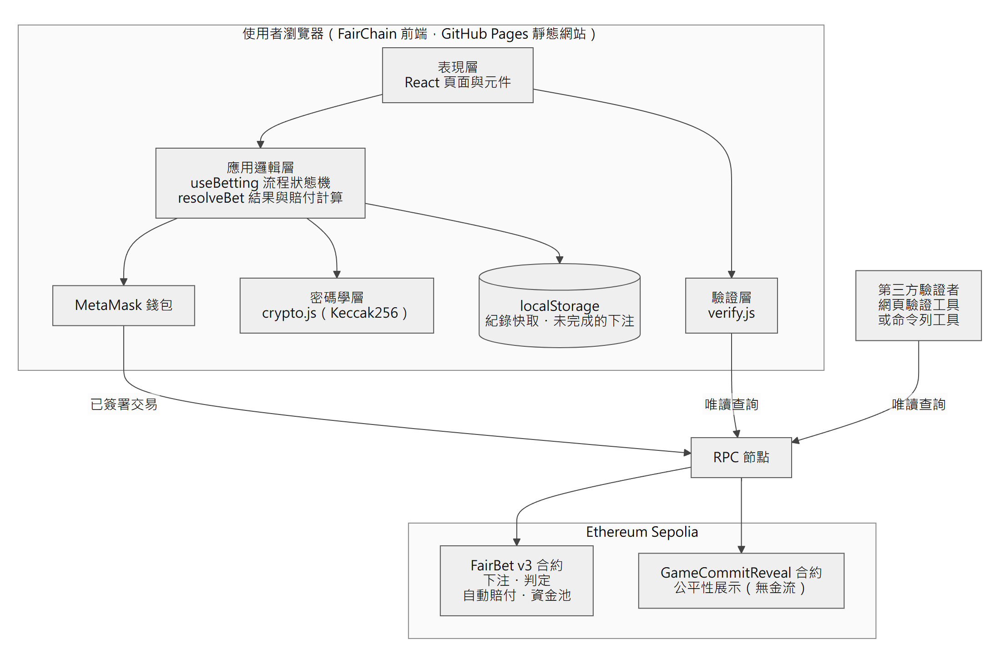

# 學習資料 第 1 部分：系統全貌與架構

> 對應專題本：第一章（1.1–1.4）、3.1、3.6
> 難度：★（六個部分中最簡單）｜預估閱讀：1 小時
> 讀完後你應該能用自己的話回答本文最後的 8 題

---

## 0. 先記住一句話

**FairChain 讓玩家「下注、開獎、賠付、驗證」都不必相信平台：亂數由玩家的承諾加上下注後才產生的區塊雜湊決定，結果由智能合約計算並賠付，任何人都能用鏈上資料重算檢查。**

被問「你們的專題在做什麼」時，先講這一句，再往下展開。

---

## 1. 要解決什麼問題（1.1 研究背景）

### 1.1 問題：結果由平台決定，玩家只能接受

線上博弈、轉蛋抽卡、電商抽獎、NFT 隨機鑄造都有同一個特徵：**結果由平台的程式決定，使用者只能被動接受**。

專題本用二十一點舉例：

- 玩家下注後，平台的程式發牌。
- 玩家無法知道這副牌是「下注前就決定好」，還是「平台看到下注金額後才產生」。
- 發牌程式跑在平台伺服器裡，外面看不到；平台若稍微調低好牌機率，單一玩家在統計上很難發現。

### 1.2 這不是技術問題，是「信任結構」的問題

- 玩家和平台之間有利益衝突（平台多贏，玩家就多輸）。
- 現在的架構卻要求玩家**單方面相信有作弊誘因的一方**。
- 政府監理靠事後稽核、抽查，做不到「每一局即時驗證」。

### 1.3 為什麼用區塊鏈

專題本引用三篇基礎文獻：

| 文獻 | 提出什麼 |
|---|---|
| Nakamoto [1]（2008） | 比特幣：不需要可信第三方的分散式帳本 |
| Buterin [2]、Wood [3] | 以太坊：區塊鏈可以執行程式（智能合約） |

區塊鏈有兩個本專題需要的性質：

1. **不可竄改性**：資料經共識確認、**達最終確定後**，難以由單一方任意修改。
2. **公開可讀性**：任何人都能讀取全部資料。

> ⚠ 注意用詞：專題本寫的是「達最終確定後難以修改」，不是「寫上去就永遠不能改」。在最終確定之前，區塊重組仍可能改變資料。口頭回答也要這樣講。

---

## 2. 現有作法哪裡不夠（1.2 研究動機）

### 2.1 業界的「可證明公平（Provably Fair）」怎麼做

典型流程：

1. 平台先公開「伺服器種子」的雜湊值（像是先把答案封進信封）。
2. 玩家提供自己的「客戶端種子」。
3. 兩個種子合起來產生遊戲結果。
4. 事後平台公開伺服器種子，玩家自己驗算。

### 2.2 三項不足（這就是研究動機，要背）

| 不足 | 白話說明 |
|---|---|
| 一、資料仍存在中心化伺服器 | 承諾、種子、紀錄都由平台保存，平台理論上可以事後整批替換；玩家缺乏有公信力的時間戳，很難舉證 |
| 二、結算仍由平台執行 | 就算亂數公平，「判定輸贏、付錢」還是平台的程式在做，可能出現「平台說你沒中」或「中了不付」 |
| 三、驗證門檻高 | 多數平台只給說明、不給工具，而且驗證時還得相信平台公布的資料是真的 |

> ⚠ 教授的最後修訂指引特別要求：這裡講的是「**典型的中心化**可證明公平機制」，不能說成「所有既有作法都只有這樣」。

### 2.3 研究問題（一句話）

**能不能讓「隨機性、結果判定、資金結算」三件事都脫離平台控制，並讓第三方不必相信平台就能驗證？**

括號裡的但書也要記得：驗證者仍然要依賴「區塊鏈共識、正確的合約程式、可用的 RPC 節點」，不是什麼都不用信。

---

## 3. 四個研究目的（1.3）

| 目的 | 內容 | 白話 |
|---|---|---|
| 一 | 設計並實作「玩家承諾＋未來區塊雜湊」的亂數協議 | 下注時沒人能算出結果，承諾也不能事後偷換；並說清楚要在什麼假設下才成立 |
| 二 | 由智能合約執行結算 | 合約自己算結果、自己付錢，平台插不了手 |
| 三 | 無須許可的驗證 | 不裝錢包、不信本網站，也能從鏈上讀資料自己重算 |
| 四 | 用多種遊戲證明架構通用，並做量化實驗 | 對抗測試、Gas、Slither、蒙地卡羅；並區分「機率分布正確」和「能防作弊」是兩回事 |

### 名稱的範圍（常被問）

題目裡的「Commit-Reveal」指的是：

- **只有玩家一方**提交種子的承諾，結算時再揭露。
- 第二份亂數來源（熵）是**下注後才產生的區塊雜湊**。
- **沒有**實作「雙方各自獨立承諾」的協議。
- 「種子承諾＋未來區塊雜湊」是既有作法（Volland [29] 等），本專題是整合應用。

---

## 4. 研究限制（1.4）

| # | 限制 | 為什麼要這樣設定 |
|---|---|---|
| 1 | 部署在 **Ethereum Sepolia 測試網**，用沒有價值的測試代幣 | 學術展示，不涉及真實金流與博弈 |
| 2 | **單人對莊家（智能合約）**，沒有多人對賭 | 範圍控制 |
| 3 | 二十一點、猜數字**不在本系統單次結算模式的範圍**，只做公平性展示 | 這兩款有中途決策或隱藏資訊；兩把種子都在玩家端，玩家能先算出結果，所以不宣稱防作弊 |
| 4 | 亂數安全依賴「開獎區塊的出塊者不和玩家串通」 | Sepolia 的驗證者是受許可的，測試網結果只能證明程式正確，不能外推主網的經濟安全 |

> ⚠ 第 3 點是教授剛要求修正的重點：要說「**不在本系統的設計範圍**」，不能說「這類遊戲技術上不能上鏈」。

---

## 5. 系統架構（3.1）

### 5.1 架構原則：無自建後端

專題本的正式寫法：

> 本系統採用**靜態網頁前端、區塊鏈智能合約與外部 RPC 服務**之架構，**不另行建置自有應用程式後端或中心化遊戲資料庫**（簡稱「無自建後端架構」）。

**為什麼刻意不做後端？** 如果保留傳統後端，平台就還握有資料，信任問題根本沒解決。

> ⚠ 不要說成「Serverless」。Serverless 指的是雲端服務商代管的執行環境，跟「我們沒有自己的後端」意思不同（教授最後修訂指引第 7 項）。

### 5.2 資料分三類（必考）

| 類別 | 內容 | 存在哪 | 遺失會怎樣 |
|---|---|---|---|
| **權威資料** | 下注時：承諾、下注金額；結算時：種子、最終隨機數、結果 | 區塊鏈 | 不會遺失，公開可讀，最終確定後難以竄改 |
| **便利性資料** | 本機遊戲紀錄、介面偏好 | 瀏覽器 localStorage | **不影響**已結算局的驗證 |
| **待結算之暫存秘密** | 還沒結算那一局的種子與盲化值（salt） | 只在玩家瀏覽器 | **該局無法結算**，期限過後下注金額留在資金池 |

**這樣分的意義：** 就算網站整個關掉、本機資料全清，**已結算的局**仍然可以由任何人從鏈上完整驗證。只有「還沒結算」的局會受影響。

> 記憶法：**鏈上的是證據，瀏覽器的是方便，沒結算的秘密是唯一的風險。**

### 5.3 六層架構（表四）

由上往下，像一個人從「看到畫面」一路走到「區塊鏈」：

| 層級 | 程式在哪 | 做什麼 |
|---|---|---|
| 表現層 | React 元件、頁面路由 | 畫面、使用者操作 |
| 應用邏輯層 | `useBetting`（流程狀態機）、`games/random.js`（結果引擎）、`games/registry.js`（遊戲清單） | 控制一局的流程、計算結果 |
| 密碼學層 | `utils/crypto.js` | 產生種子與盲化值、計算與驗證承諾 |
| 錢包層 | `context/WalletContext.jsx` | MetaMask 連線、切換網路、取得簽署者 |
| 鏈上互動層 | `utils/contract.js` | 包裝合約讀寫、提供**唯讀 Provider** |
| 區塊鏈層 | `FairBet.sol`、`GameCommitReveal.sol` | 收注、驗證承諾、判定結果、依規則賠付、管理資金池 |

**唯讀 Provider 是重點：** 它用公開的 RPC 節點讀鏈上資料，而不是用玩家的錢包。所以第三方驗證者**不用裝 MetaMask、不用有帳號**就能驗證——這直接對應研究目的三。

架構圖見專題本**圖一**（`docs/專題本/圖/fig01_architecture.png`）。



### 5.4 兩份合約（3.1.3）

| 合約 | 用在哪 | 能做到什麼 | 做不到什麼 |
|---|---|---|---|
| **FairBet.sol（v3）** | 9 種遊戲類型（網站上 8 個下注頁面，骰子頁包含骰子與猜硬幣） | 完整的下注、判定、賠付；亂數＝玩家承諾＋未來區塊雜湊 | 殘餘風險：玩家與出塊者串通 |
| **GameCommitReveal.sol** | 二十一點、猜數字 | 證明「揭露的值和當初承諾的一樣」（沒有偷換） | **沒有金流**；兩把種子都在玩家端，無法證明來源獨立，玩家可先算出牌堆或密碼 |

**為什麼這樣分？兩個判斷標準：**

1. **結果能不能用公開參數和 finalRandom 一次算出來？** 能 → 可以用本系統的單次結算模式上鏈（FairBet）。
2. **有沒有要在玩家行動時保密的資訊？** 有 → 一個隨機數撐不起防作弊（例如二十一點的牌堆）。

### 5.5 遊戲總覽（11 款）

| 類別 | 遊戲 | 合約 |
|---|---|---|
| 鏈上下注（8 頁、9 種類型） | 骰子／猜硬幣、輪盤、拉霸、Crash、Limbo、幸運轉盤、Plinko、左輪 | FairBet v3 |
| 公平性展示（不防作弊） | 二十一點、猜數字 | GameCommitReveal |
| 本機展示 | 挖礦（工作量證明教學） | 不上鏈 |

沒連 MetaMask 時，下注遊戲會進入**模擬模式**：流程相同，但開獎用的熵由本機產生、不上鏈、沒有金流（專題本圖九）。

---

## 6. 一局遊戲大概怎麼跑（只要懂流程，細節屬於第 6 部分）

```
① 下注：玩家在瀏覽器產生「種子＋盲化值」，只把它們的雜湊（承諾）和下注金額送上合約
        合約記下：開獎區塊 = 下注區塊 + 1
② 等待：等開獎區塊產生（下注當下它還不存在，所以沒人算得出結果）
③ 結算：玩家揭露種子，合約檢查承諾、取開獎區塊的雜湊、算出結果並付錢
④ 驗證：任何人讀鏈上資料，自己重算五項（承諾、區塊熵、最終亂數、結果、賠付）
```

一局要簽兩次名（下注、結算）。逾期 256 個區塊沒結算，任何人都能把該局標成「過期」，下注金額留在資金池。

---

## 7. 開發環境與技術選型（3.6）

### 7.1 主要技術（表八，挑重點記）

| 技術 | 版本 | 為什麼選 |
|---|---|---|
| React | 18 | 元件化、生態成熟 |
| Vite | 5 | 啟動快、熱重載 |
| **ethers.js** | **6** | 內建 `solidityPackedKeccak256`，算出的雜湊和合約完全一致 |
| **Solidity** | **0.8.24** | 0.8 以上內建整數溢位檢查 |
| Hardhat | 2 | 本地鏈測試、Gas 報告、部署腳本 |
| Vitest／Hardhat＋Chai | — | 前端測試／合約測試 |
| Slither | 0.11.6 | 靜態安全分析（Feist 等人 [10]） |
| **Ethereum Sepolia** | chainId 11155111 | 官方測試網、水龍頭好取得、區塊瀏覽器完整 |
| GitHub Pages＋Actions | — | 免費、和版本控制整合、自動部署 |

> 最可能被追問的是 ethers.js v6：前端算承諾用的雜湊方式，**必須和合約一模一樣**，否則交易會被拒絕。

### 7.2 開發流程：合約先行、測試驅動（3.6.1）

1. 合約的 `resolve()` 和前端的 `resolveBet()` 寫同一套公式。
2. 合約測試**直接載入前端的 `random.js`** 來比對，而不是另寫一份模型——確保測到的是網站真正在跑的程式。
3. 測試檢查前端 ABI（合約介面描述）和合約編譯結果一致。
4. 安全需求寫成**反例測試**（「攻擊者做不到什麼」），不只測正常情況能成功。
5. 推送到主分支時，CI 先跑完前端與合約全部測試（共 112 項），**任何一項失敗就不部署**。
6. 部署腳本拒絕從有未提交修改的工作目錄部署到公開網路，並把 commit、編譯設定、部署區塊記錄下來。

### 7.3 秘密管理（3.6.2）

- 部署用的私鑰放在 `contracts/.env`，已列入 `.gitignore`，不會上傳到 GitHub。
- 所有測試帳號只放沒價值的測試代幣，**絕不存放真實資產**。
- 網站建置後、部署前，會檢查產出的檔案裡有沒有私鑰字串。

---

## 8. 名詞小辭典

| 名詞 | 一句話解釋 |
|---|---|
| 種子（seed） | 玩家在瀏覽器產生的 256 位元隨機值 |
| 盲化值（salt） | 加在種子旁邊的另一個隨機值，防止別人用窮舉猜出種子 |
| 承諾（commitment） | `keccak256(seed‖salt)`：先公開這個雜湊，之後再揭露 seed 和 salt |
| 熵（entropy） | 開獎區塊的雜湊，是第二份亂數來源 |
| finalRandom | `keccak256(seed‖開獎區塊雜湊)`，決定結果的隨機數 |
| 開獎區塊（revealBlock） | 下注區塊的下一個區塊（N＋1） |
| RPC 節點 | 讓程式讀取區塊鏈資料的伺服器（公開服務） |
| 唯讀 Provider | 只讀不寫、不需錢包的鏈上連線 |
| 最終確定（finality） | 區塊已無法被重組推翻的狀態；Sepolia 實測約 16 分鐘 |
| 模擬模式 | 沒連錢包時的展示模式：流程相同，但不上鏈 |

---

## 9. 練習題（先自己答，再對答案）

**Q1. 用三句話說明你們的專題在解決什麼問題。**
> 線上博弈的結果由平台單方面產生，玩家無法確認平台是否在下注後才決定結果。現有的中心化可證明公平機制只解決了「種子不可事後更換」，資料保存、判定、付款仍依賴平台。本專題把這些環節移到智能合約，並讓第三方能用鏈上資料自行重算驗證。

**Q2. 為什麼你們不做後端伺服器？這叫 Serverless 嗎？**
> 有自建後端，平台就仍握有資料，信任問題沒解決。這不叫 Serverless；正確說法是「靜態前端＋智能合約＋外部 RPC 服務，不另建自有後端或中心化資料庫」。

**Q3. 系統資料分哪三類？如果網站關掉了，還能驗證嗎？**
> 權威資料（鏈上）、便利性資料（localStorage）、待結算的暫存秘密（瀏覽器）。網站關掉後，已結算的局仍可從鏈上完整驗證；只有尚未結算的局，若玩家瀏覽器裡的種子遺失就無法結算。

**Q4. 第三方驗證者需要裝 MetaMask 嗎？為什麼？**
> 不需要。鏈上互動層提供唯讀 Provider，用公開 RPC 節點讀資料，不需要錢包或帳號。

**Q5. 為什麼有兩份合約？**
> FairBet 處理結果能用公開參數與 finalRandom 一次算出的 9 種遊戲，負責下注、判定、賠付。二十一點、猜數字有中途決策或隱藏資訊，不在本系統單次結算模式的範圍，所以用 GameCommitReveal 只做公平性展示、沒有金流。

**Q6. 二十一點是不是技術上不可能上鏈？**
> 不是。是本系統只做「單次取得亂數、一次結算」的模式，沒有設計多階段鏈上狀態機；這是設計範圍的限制，不是技術上不可能。

**Q7. 為什麼選 ethers.js v6？**
> 它內建 `solidityPackedKeccak256`，算出的雜湊和合約的 `keccak256(abi.encodePacked(...))` 在位元層級完全相同；不一致的話，結算交易會因承諾不符被拒絕。

**Q8. 你們怎麼避免私鑰外洩？**
> 私鑰放在已列入 `.gitignore` 的 `contracts/.env`；測試帳號只放測試代幣；部署前檢查建置產物沒有私鑰字串。

---

## 10. 容易答錯的地方

| 錯誤說法 | 正確說法 |
|---|---|
| 區塊鏈資料寫上去就永遠不能改 | 達**最終確定後**難以由單一方任意修改 |
| 我們是 Serverless 架構 | 無自建後端架構（靜態前端＋合約＋外部 RPC） |
| 現有可證明公平都只解決一項 | **典型中心化**的可證明公平機制仍依賴平台 |
| 二十一點不能上鏈 | 不在本系統單次結算模式的**設計範圍** |
| 驗證完全不用信任任何東西 | 仍要依賴區塊鏈共識、正確的合約程式與可用的 RPC |
| 我們發明了玩家承諾＋未來區塊雜湊 | 是既有作法（Volland [29] 等），本專題是整合應用 |

---

## 讀完自我檢查

- [ ] 能用一句話說出專題在做什麼
- [ ] 能說出可證明公平的三項不足
- [ ] 能說出四個研究目的
- [ ] 能畫出（或說出）三類資料、各存在哪、遺失的後果
- [ ] 能說出六層架構的名稱
- [ ] 能解釋為什麼有兩份合約、為什麼二十一點只做展示
- [ ] 第 10 節的六個錯誤說法都能改正
